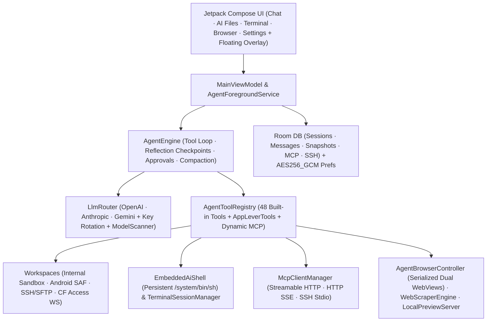

<div align="center">

# ForgeMind

**Autonomous AI Engineering Agent & Multi-Environment Workspace for Android**

[](https://github.com/DIIIUA/ForgeMind/releases/latest)
[](https://github.com/DIIIUA/ForgeMind/actions/workflows/android-ci.yml)
[](LICENSE)
[-3ddc84?style=for-the-badge&logo=android&logoColor=white)](#build--test)
[](#tech-stack)

**Languages:** **English** · [Русский](README.ru.md)

*A native Kotlin + Jetpack Compose command center for reasoning LLMs, autonomous tool-calling loops, Sora code editing with rollback snapshots, local + Termux/Cloudflare SSH shells, dual isolated WebViews, and MCP servers.*

[**⬇ Download Ready-to-Install `.apk` (GitHub Releases)**](https://github.com/DIIIUA/ForgeMind/releases/latest) · [Out of the Box vs. Termux](#out-of-the-box-vs-optional-termux-ssh) · [1-Minute Setup Guides](#1-minute-setup-guides-termux--remote-ssh--mcp) · [Capabilities](#capabilities) · [Architecture](#architecture) · [License](#license--commercial-rights)

</div>

---

## Interface Showcase

| Autonomous Chat & Diff Cards | AI Files & Sora Editor | Live Shell & Agent Browser | Contextual Setup Guides & MCP |
| :---: | :---: | :---: | :---: |
|  |  |  |  |

---

## Overview

**ForgeMind** turns an Android phone or tablet into a genuine autonomous AI engineering workspace rather than a passive chat wrapper. Built natively with Kotlin and Jetpack Compose—without bundling a bloated gigabyte-scale PRoot image inside the APK—it gives reasoning models controlled, auditable access to:

1. **Cloudflare Access WebSocket SSH (`wss://`) out of the box** — connect to home servers or Termux behind Cloudflare Zero Trust using `CF-Access-Client-Id/Secret` headers with **zero open ports** and **no `cloudflared` binary** on Android.
2. **Sora Editor (TextMate) + Pre-Edit Rollback Snapshots + Loopback `LocalPreviewServer`** — syntax-highlighted editing, instant unified diff rollback, and live localhost preview alongside your chat.
3. **Workspace Triad (`internal` + `saf` + `termux_ssh`) & `MCP SSH_STDIO`** — seamless collaboration across the app sandbox, user-chosen Android folders, local Termux, remote Linux hosts, and stdio/HTTP MCP servers.
4. **Forced Reflection Checkpoints (`thinkEveryToolCalls`) & Safe Context Compaction (`78%`)** — prevents runaway agent loops while keeping tool-call chains intact during long multi-step sessions.

---

## Out of the Box vs. Optional Termux SSH

ForgeMind is completely usable **the second you install the APK** and paste an API key (or point it at local/LAN Ollama). Nothing from any developer's personal phone setup is assumed or required:

| Capability | Works Immediately (APK Only) | With Optional Fresh Termux (`127.0.0.1:2222`) or Remote SSH |
| :--- | :--- | :--- |
| **File Workspaces** | **AI Home (`internal`)** sandbox + **Android Folder (`saf`)** via system picker | Full SFTP & filesystem access across Termux (`~`) and remote Linux servers |
| **Shell Execution** | Persistent `/system/bin/sh` (`EmbeddedAiShell`) with standard Android POSIX / `toybox` utilities (`ls`, `grep`, `sed`, `curl`, etc.) | Full Linux packages (`python3`, `nodejs`, `git`, `clang`, `ffmpeg`, `pytest`, `uvx`, `npx`, custom CLI tools) |
| **Document & Media Reading** | Native text/code, `PDF` text (`pdfbox-android`), `DOCX`/`XLSX`/`PPTX`/`ODT`/`ODS`/`ODP`/`RTF` XML extraction, `ZIP` inspection, image viewing (no bundled OCR) | Any custom OCR / data-science / media pipeline you install in Termux or on your server (`tesseract`, `pymupdf`, `pandas`, etc.) |
| **Code Editor & Web** | **Sora Editor**, diff snapshots, dual isolated WebViews, DuckDuckGo search, `LocalPreviewServer` | Preview & test live backend servers (`FastAPI`, `Vite`, `Flask`, `Next.js`) running in Termux or over SSH |
| **Voice & MCP** | Offline Android STT & TTS, Cloud Whisper/TTS, HTTP & SSE MCP gateways | **`SSH_STDIO` MCP servers** (`npx`, `uvx`, `python3`) launched directly inside Termux or remote SSH |

> [!TIP]
> Every setup screen inside the app (**Environments**, **Terminal `?`**, **MCP Servers**, and **Voice**) includes a built-in collapsible **Quick Guide** with one-tap command copy and starter templates—no intrusive startup wizard.

---

## 1-Minute Setup Guides (Termux · Remote SSH · MCP)

### A. Local Termux over SSH (1 Minute)
1. Install [Termux](https://github.com/termux/termux-app/releases) (from F-Droid or GitHub Releases — avoid the outdated Play Store build).
2. Run this one-liner in Termux (also copyable in one tap inside **Settings → Environments** or **Terminal → `?`**):
   ```bash
   pkg update -y && pkg install -y openssh && passwd && sshd -p 2222
   ```
3. Run `whoami` in Termux to check your username (e.g., `u0_a312`), open **ForgeMind → Settings → Environments**, enter that username + your password for `Termux (local)` (`127.0.0.1:2222`), and tap **Save**.

### B. Remote PC or Home Server SSH (Without Port Forwarding)
- **Option 1 — Tailscale (simplest):** Install [Tailscale](https://tailscale.com/) on your PC/server and Android phone, enable OpenSSH on your computer, and add an SSH profile in ForgeMind pointing to your Tailscale IP (`100.x.y.z:22`).
- **Option 2 — Cloudflare Zero Trust Tunnel:** Expose `ssh://localhost:22` on your server via `cloudflared`, protect the hostname with a Cloudflare Access Service Token, and enable **Cloudflare Access tunnel (`wss://`)** in ForgeMind's SSH profile. ForgeMind tunnels SSH natively over WebSockets with zero extra binaries on your phone.

### C. Connecting MCP Servers
Open **Settings → MCP Servers** and tap any built-in starter template chip or **Add**:
- **Remote / LAN Gateways (`STREAMABLE_HTTP` or `HTTP_SSE`):** Enter the endpoint URL (`https://.../mcp` or `/sse`) plus optional `Bearer`, `Basic`, custom `API Key`, or `CF-Access` credentials.
- **Local CLI Servers (`SSH_STDIO`):** Run standard stdio MCP servers directly inside Termux or remote SSH (for example, `npx -y @modelcontextprotocol/server-filesystem ~` or `python3 -m mcp_server_fetch`).

---

## Capabilities

### 1. Multi-Provider LLM Router & Model Discovery
Supports native wire protocols (`OPENAI_COMPAT`, `ANTHROPIC`, `GEMINI`) across 13 provider presets:

| Provider Presets | Highlights |
| :--- | :--- |
| **OpenAI / Anthropic / Google Gemini** | Direct SSE streaming, native tool calling, configurable reasoning / thinking budgets |
| **OpenRouter / DeepSeek / Groq / xAI Grok / Mistral** | Fast inference, automatic model catalog scanning, unified OpenAI-compatible streaming |
| **Venice AI** | Full multi-modal `/models?type=all` catalog discovery (`text`, `code`, `image`, `tts`, `asr`, `embedding`, `video`), `model_spec` context & beta metadata, category filter chips |
| **NVIDIA NIM / Cloudflare Workers AI / HuggingFace** | Open-weights & specialized inference endpoints |
| **Ollama & Custom OpenAI / LiteLLM** | Local LAN / Termux / tunneled models with custom HTTP headers JSON and DNS-over-HTTPS fallback |

- **API Key Rotation:** Store multiple API keys per provider with automatic failover on `429` / rate-limit errors.
- **Context Compactor:** Automatic conversation summarization (`compactThresholdPercent`, default `78%`) that preserves tool-call boundaries (`safeCompactionSplitIndex`).

### 2. Autonomous Agent Engine & 48 Built-In Tools
Runs inside a lifecycle-aware `AgentForegroundService` (`dataSync`) so multi-step engineering tasks continue reliably when switching apps:

<details>
<summary><strong>Click to expand all 48 built-in tools & safety controls</strong></summary>

- **Environment, Files & Rollback Snapshots (`internal`, `termux_ssh`, `saf`):**
  `check_environment_status`, `list_files`, `search_files`, `search_codebase` (regex grep), `file_info`, `file_read` (with line offsets & built-in PDF/Office text extraction), `file_write`, `file_edit` (exact replacement + unified diff), `file_move`, `file_delete`, `create_folder`, `archive_create`, `archive_extract`, `transfer_file`, `send_file_to_chat`, `snapshot_list`, `snapshot_restore`
- **Embedded Shell, SSH & Visible Terminal Tabs:**
  `run_command` (SSH/Termux with automatic fallback to persistent embedded `/system/bin/sh`), `run_command_async` (background PID + log path), `check_command_status`, `kill_command`, `terminal_list_tabs`, `terminal_open_tab`, `terminal_send`
- **Dual Isolated WebViews, Web Search & Local Preview Server:**
  `web_search` (DuckDuckGo, Tavily, Brave, Google CSE, or SearXNG), `web_scrape`, `browser_open`, `browser_agent_mode`, `browser_agent_navigate`, `browser_agent_inspect` (DOM + indexed interactive elements + JS console errors), `browser_agent_act` (`click`, `type`, `scroll`, `wait`, `back`, `forward`, `reload`, `clear`), `browser_agent_eval_js`, `browser_agent_screenshot` (mutex-serialized with visual frame commit sync), `preview_server_control`
- **Code Editor, Chat Workspace, Navigation & Voice:**
  `editor_open_file`, `editor_list_tabs`, `chat_list_sessions`, `chat_search_history`, `chat_read_session`, `chat_manage`, `chat_export_markdown`, `context_compact`, `app_navigate`, `voice_speak`
- **Model Context Protocol (MCP):**
  `mcp_list_servers`, `mcp_connect`, `mcp_call_tool`, `mcp_read_resource` + dynamic registration of tools from enabled MCP servers (`STREAMABLE_HTTP`, `HTTP_SSE`, `SSH_STDIO`), `initialize.instructions` prompt injection, gateway catalog detection, and binary image attachment forwarding (`PNG`/`WEBP`/`JPEG`).
- **Granular Guardrails:**
  - Category-level auto-approval toggles (safe reads/writes, file deletion, shell commands, browser JS, MCP calls), explicit tool allowlists/blocklists, and destructive shell command interception (`rm -rf`, `mkfs`, etc.)
  - Automatic pre-edit **File Snapshots** (`FileSnapshotEntity`) for instant one-tap or agent-driven rollback
  - **Max Turn Guard** (`maxTurns`, default `100`) & **Forced Reflection Checkpoints** (`thinkEveryToolCalls`, default `25`)

</details>

### 3. Localization (14 Languages)
Complete English default resources (`res/values/strings.xml`) with instant in-app switching in **Settings → Interface Language**:

`System default` · `English` · `Русский` · `Español` · `中文 (简体)` · `العربية` · `हिन्दी` · `Português` · `Français` · `Deutsch` · `日本語` · `한국어` · `Türkçe` · `Українська`

---

## Architecture



<details>
<summary><strong>Project Structure (`app/src/main/java/com/forgemind/app`)</strong></summary>

```text
app/src/main/java/com/forgemind/app/
├── agent/       # AgentEngine, AgentTools, AppLeverTools, AgentForegroundService
├── bridge/      # WorkspaceManager, EmbeddedAiShell, InAppDocumentParser, ArchiveUtils, TermuxBridge, TerminalSessionManager, CloudflareAccessSshSupport, DiffUtils
├── data/
│   ├── archive/ # ChatArchiveManager (Markdown export, ZIP backup/restore)
│   ├── db/      # Room database (exported schemas), Entities, DAOs
│   ├── model/   # DomainModels, Provider presets, Settings, Tool cards, Attachments
│   └── prefs/   # DataStore + AES256_GCM EncryptedSharedPreferences
├── floating/    # FloatingChatService (draggable overlay bubble & resizable mini-chat window)
├── i18n/        # LocaleHelper & 14-language AppLanguage configuration
├── llm/         # LlmRouter, OpenAiCompatibleClient, AnthropicClient, GeminiClient, ContextCompactor, ModelScanner
├── mcp/         # McpClientManager (Streamable HTTP, HTTP+SSE, SSH Stdio)
├── ui/          # MainViewModel, ChatScreen, FilesScreen, DocumentContentViewer, TerminalScreen, PreviewScreen, SettingsScreen, ModelSelectorButton
├── voice/       # AudioRecorder, SttManager, SttFallbackPolicy, TtsManager
└── web/         # AgentBrowserController, WebScraperEngine, LocalPreviewServer
```

</details>

---

## Tech Stack

- **Language & Build:** Kotlin `2.2.21`, Android Gradle Plugin `8.13.2`, KSP `2.2.21-2.0.5`, Java `17` + core library desugaring
- **UI:** Jetpack Compose BOM `2025.09.00`, Material 3, AppCompat per-app locales, Navigation Compose, Coil `2.7.0`, Sora Editor `0.23.6` (TextMate)
- **Persistence & Security:** Room `2.8.5`, DataStore Preferences, `androidx.security:security-crypto` (`AES256_GCM` for API keys and SSH secrets)
- **Networking & Parsing:** OkHttp `4.12.0` (SSE + WebSockets + DoH fallback), `mwiede/jsch` `2.28.8` (SSH/SFTP), Jsoup `1.20.1`, PDFBox Android `2.0.27.0`

---

## Build & Test

### Download Pre-Built APK
Grab the latest ready-to-install Android package directly from [**GitHub Releases**](https://github.com/DIIIUA/ForgeMind/releases/latest).

### Build from Source
1. Install JDK `17` and Android SDK (`compileSdk 36`, `minSdk 29`), and set `ANDROID_HOME` (or `sdk.dir` in `local.properties`).
2. Run all unit tests and assemble the debug APK:
   ```bash
   ./gradlew testDebugUnitTest assembleDebug
   ```

> [!NOTE]
> Zero API keys, private server addresses, or personal credentials are bundled in this repository. All provider keys, SSH credentials, and MCP headers are configured locally on your device and stored in `AES256_GCM` encrypted preferences.

---

## License & Commercial Rights

Copyright © 2026 **DIIIUA**.

- **Open-Source License (`GPL-3.0`):** This public repository is free and open-source software licensed under the [**GNU General Public License v3.0**](LICENSE) (OSI & FSF approved). Anyone may inspect, build, modify, and redistribute derivative works under the terms of `GPL-3.0`.
- **Commercial Dual-Licensing & Store Distribution:** As the original copyright holder, **DIIIUA** retains the full right to distribute official builds of **ForgeMind** (including paid tiers, proprietary plugins, or store-compliant packages on Google Play, Apple App Store, Galaxy Store, and enterprise channels) under separate commercial terms.
- **Contributor License Grant:** By submitting a pull request or contribution to this repository, you grant **DIIIUA** a perpetual, worldwide, non-exclusive, royalty-free, irrevocable license to use, modify, and distribute your contribution under both `GPL-3.0` and commercial / app-store licenses, while retaining your own copyright. The **ForgeMind** name and branding remain the property of **DIIIUA**.
