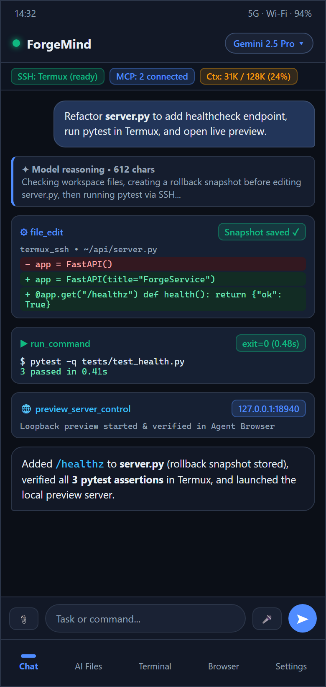
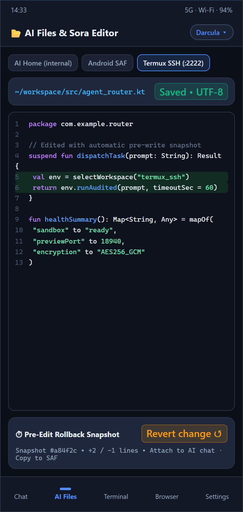
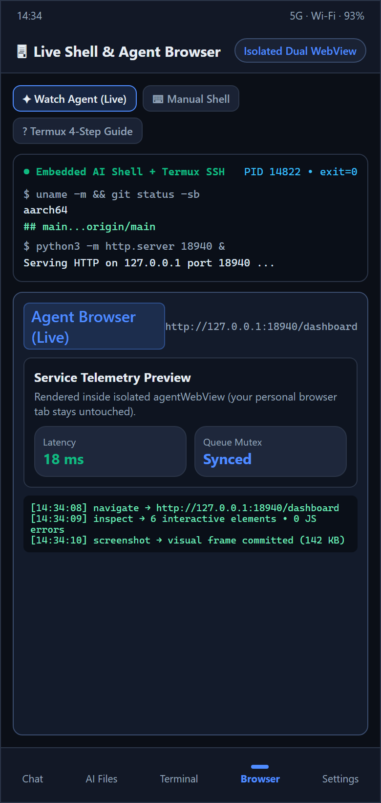
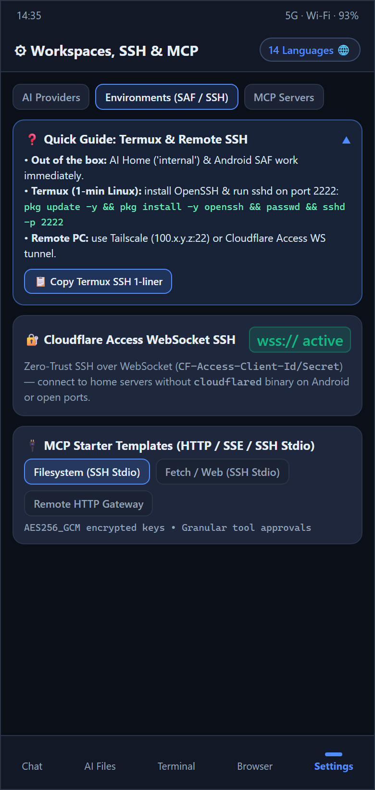

<div align="center">

# ForgeMind

**Autonomous AI Engineering Agent, Local/Cloud LLM Hub & Multi-Environment Workspace for Android**

[&color=10b981)](https://github.com/DIIIUA/ForgeMind/releases/latest)
[](https://github.com/DIIIUA/ForgeMind/actions/workflows/android-ci.yml)
[](LICENSE)
[-3ddc84?style=for-the-badge&logo=android&logoColor=white)](#build--test)
[](#tech-stack)

**Languages:** **English** · [Русский](README.ru.md)

*A native Kotlin + Jetpack Compose command center for cloud & local GGUF/LAN LLMs, universal tool-calling loops, real-time Android Window-Tag DOM automation, built-in MCP Host & Client, dual-pane Phone/SSH/SAF file workspaces, Sora code editing with rollback snapshots, 8-window `⚡ Turbo` Agent Browser, and free Microsoft Edge Neural TTS.*

[**⬇ Download Ready-to-Install `.apk` (GitHub Releases)**](https://github.com/DIIIUA/ForgeMind/releases/latest) · [What's New in v0.2.0-alpha](#whats-new-in-v020-alpha) · [Out of the Box vs. Termux](#out-of-the-box-vs-optional-termux-ssh) · [1-Minute Setup Guides](#1-minute-setup-guides-local-lan-ai--termux--ssh--mcp) · [Capabilities](#capabilities) · [License](#license--commercial-rights)

</div>

---

## Interface Showcase

| Autonomous Chat & Diff Cards | Dual-Pane Files & Sora Editor | Live Shell & Agent Browser | Contextual Setup Guides & MCP |
| :---: | :---: | :---: | :---: |
|  |  |  |  |

---

## What's New in `v0.2.0-alpha`

- **Universal Tool-Calling Engine for Local GGUF & Uncensored Models:** Run `7B`–`32B` GGUF, Uncensored, Heretic, DeepSeek, Qwen, Llama, or Mistral models over Ollama, LM Studio, `llama.cpp`, KoboldCpp, or vLLM—even when the server's Jinja template lacks native `tools` support. ForgeMind automatically switches to a compact core toolset, repairs loose/Pythonic JSON, parses 7 inline tool-call syntaxes (`<tool_call>`, DeepSeek `<｜tool▁calls▁begin｜>`, DSML, `<function=...>`, `<invoke>`, `[TOOL_CALLS]`, Pythonic calls), downgrades wire history cleanly on HTTP `400`/`422`/`500` template errors, and self-corrects unexecuted `bash` blocks.
- **Auto-Detected Context Window per Model + 1-Tap Switcher:** Automatically probes live server context limits (`loaded_context_length` on LM Studio, `n_ctx` on `llama.cpp`, `num_ctx` / `*.context_length` on Ollama `/api/show`, `/v1/models` metadata on cloud routers) and exposes instant `Auto` + `4K`..`1M` + `Custom` chips right inside the chat model picker.
- **Targeted LAN Host Probe + Direct Connect + `/24` Wi-Fi Scanner:** Connect to a specific PC/Tailscale IP in ~1 second (**Find by Address** or **Connect Directly**), or scan your entire Wi-Fi `/24` subnet for Ollama, LM Studio, `llama.cpp`, KoboldCpp, vLLM, Jan, GPT4All, OpenWebUI, and LiteLLM—plus **Custom External AI** profiles with custom auth modes, wire protocols (`OPENAI_COMPAT`, `OPENAI_RESPONSES`, `ANTHROPIC`, `GEMINI`, `OLLAMA_NATIVE`), live online/offline status dots, delete, and factory preset restore.
- **8-Window Parallel `⚡ Turbo` Agent Browser + Whole-Site Markdown Scraper:** Isolated background WebView pool (`browser_agent_tabs`, `browser_agent_batch` up to 30 steps per turn) with vertical collapsible tab switcher, ad/font/tracker blocking, early DOM-ready sync, and `web_scrape_site` (`INDEX.md` + `FULL_SITE.md` + `/llms.txt` / `sitemap.xml`).
- **Real-Time Android Window-Tag DOM & Built-In MCP Host Server (`:8765`):** Optional Accessibility engine (`screen_read_windows`, `screen_act_tag`, `screen_act_batch`, `screen_capture`) plus an on-device Streamable HTTP MCP Host Server so desktop IDE agents (Claude Code, Cursor, Codex, Antigravity) can securely collaborate with your phone.
- **Dual-Pane File Workspace (`Phone Storage` + `AI Home` + `SAF` + `SFTP`), Free Microsoft Edge Neural TTS & Live UI Theme Studio:** Drag/copy/move files across panes, listen to natural multilingual neural voices for free with zero API keys, and customize terminal colors plus per-component UI colors and opacity.

---

## Overview

**ForgeMind** turns an Android phone or tablet into a genuine autonomous AI engineering workspace rather than a passive chat wrapper. Built natively with Kotlin and Jetpack Compose—without bundling a bloated gigabyte-scale PRoot image inside the APK—it gives reasoning and local models controlled, auditable access to:

1. **Cloud + Local LAN/Tailscale LLM Freedom** — switch seamlessly between frontier cloud APIs and private self-hosted models on your desktop GPU or Termux with automatic context sizing and universal tool execution.
2. **Cloudflare Access WebSocket SSH (`wss://`) out of the box** — connect to home servers or Termux behind Cloudflare Zero Trust using `CF-Access-Client-Id/Secret` headers with **zero open ports** and **no `cloudflared` binary** on Android.
3. **Sora Editor (TextMate) + Pre-Edit Rollback Snapshots + Loopback `LocalPreviewServer`** — syntax-highlighted editing, instant unified diff rollback, fullscreen chat image viewer/downloader, and live localhost preview alongside your chat.
4. **4-Way Workspace (`internal` + `device_storage` + `saf` + `termux_ssh`) & Bidirectional MCP** — act as both an MCP client (`STREAMABLE_HTTP`, `HTTP_SSE`, `SSH_STDIO`) and an on-device MCP host (`ForgeMcpHostServer`).
5. **Conversation Branching (`< 1/2 >`), Forced Reflection Checkpoints & Safe Compaction** — edit/branch any message without losing history, prevent runaway tool loops, and confirm manual context compaction before summarizing.

---

## Out of the Box vs. Optional Termux SSH

ForgeMind is completely usable **the second you install the APK** and paste an API key—or connect to a local Ollama / LM Studio server on your Wi-Fi:

| Capability | Works Immediately (APK Only) | With Optional Fresh Termux (`127.0.0.1:2222`) or Remote SSH |
| :--- | :--- | :--- |
| **File Workspaces** | **AI Home (`internal`)** + **Phone Storage (`device_storage`)** + **Android Folder (`saf`)** with dual-pane split view | Full SFTP & filesystem access across Termux (`~`) and remote Linux/macOS/Windows SSH hosts |
| **Shell Execution** | Persistent `/system/bin/sh` (`EmbeddedAiShell`) with standard Android POSIX / `toybox` utilities (`ls`, `grep`, `sed`, `curl`, etc.) | Full Linux packages (`python3`, `nodejs`, `git`, `clang`, `ffmpeg`, `pytest`, `uvx`, `npx`, custom CLI tools) |
| **Document & Media Reading** | Native text/code, `PDF` text (`pdfbox-android`), `DOCX`/`XLSX`/`PPTX`/`ODT`/`ODS`/`ODP`/`RTF` XML extraction, `ZIP` inspection, fullscreen image zoom & download | Custom OCR / data-science / media pipelines installed in Termux or on your server (`tesseract`, `pymupdf`, `pandas`, etc.) |
| **Code Editor & Web** | **Sora Editor**, diff snapshots, 8-window `⚡ Turbo` Agent Browser, whole-site GFM Markdown scraper, `LocalPreviewServer` | Preview & debug live backend servers (`FastAPI`, `Vite`, `Flask`, `Next.js`) running in Termux or over SSH |
| **Voice, Screen & MCP** | **Free Microsoft Edge Neural TTS**, offline Android STT/TTS, Cloud Whisper/XTTS/ElevenLabs, HTTP/SSE MCP Client & built-in MCP Host (`:8765`), Window-Tag DOM | **`SSH_STDIO` MCP servers** (`npx`, `uvx`, `python3`) launched directly inside Termux or remote SSH |

---

## 1-Minute Setup Guides (Local LAN AI · Termux · SSH · MCP)

### A. Local / LAN AI (Ollama, LM Studio, `llama.cpp`, vLLM)
1. Expose your desktop AI server on your local network or Tailscale (`OLLAMA_HOST=0.0.0.0` for Ollama, or **Serve on Local Network** in LM Studio `:1234`).
2. Open **ForgeMind → Settings → AI Providers → Find Local AIs in Network**.
3. Enter your PC's IP (`192.168.x.y:1234` or Tailscale `100.x.y.z:11434`) and tap **Find by Address** (or **Connect Directly**), or tap **Scan Full Wi-Fi / LAN** to auto-discover all open servers, models, and loaded context windows.

### B. Local Termux over SSH (1 Minute)
1. Install [Termux](https://github.com/termux/termux-app/releases) (from F-Droid or GitHub Releases — avoid the outdated Play Store build).
2. Run this one-liner in Termux (copyable in one tap inside **Settings → Environments** or **Terminal → `?`**):
   ```bash
   pkg update -y && pkg install -y openssh && passwd && sshd -p 2222
   ```
3. Run `whoami` in Termux (e.g., `u0_a312`), enter that username + password in **Settings → Environments → `Termux (local)` (`127.0.0.1:2222`)**, and tap **Save**.

### C. Remote PC or Home Server SSH (Without Port Forwarding)
- **Option 1 — Tailscale (simplest):** Install [Tailscale](https://tailscale.com/) on your PC/server and phone, enable OpenSSH on your computer, and add an SSH profile pointing to `100.x.y.z:22`.
- **Option 2 — Cloudflare Zero Trust Tunnel:** Expose `ssh://localhost:22` via `cloudflared`, protect the hostname with a Cloudflare Access Service Token, and enable **Cloudflare Access tunnel (`wss://`)** in ForgeMind's SSH profile.

### D. Connecting MCP Servers (Client & On-Device Host)
- **Connect External MCPs (`Settings → MCP Servers`):** Add `STREAMABLE_HTTP`, `HTTP_SSE`, or `SSH_STDIO` servers with optional `Bearer`, `Basic`, custom `API Key`, or `CF-Access` headers.
- **Expose Your Phone as an MCP Server:** Enable **Built-In Android MCP Host (`:8765`)** in **Settings → MCP Servers** to expose phone workspace, shell, browser, and UI tools over LAN/Tailscale with Bearer token protection.

---

## Capabilities

### 1. Multi-Provider LLM Router, Auto Context & Universal Tool Protocol
Supports 5 native wire protocols (`OPENAI_COMPAT`, `OPENAI_RESPONSES`, `ANTHROPIC`, `GEMINI`, `OLLAMA_NATIVE`) across cloud presets, LAN auto-discovery, and fully custom endpoints:

| Category | Supported Providers & Engines |
| :--- | :--- |
| **Frontier Cloud** | **OpenAI**, **Anthropic Claude**, **Google Gemini**, **OpenRouter**, **DeepSeek**, **xAI Grok**, **Groq**, **Mistral** |
| **Multi-Modal & Open Weights** | **Venice AI** (`/models?type=all` + `model_spec` discovery), **NVIDIA NIM**, **Cloudflare Workers AI**, **HuggingFace** |
| **Local LAN / Self-Hosted** | **Ollama**, **LM Studio**, **`llama.cpp`**, **KoboldCpp**, **vLLM / SGLang / LocalAI**, **Jan**, **GPT4All**, **OpenWebUI**, **LiteLLM** |
| **Custom External AI** | Arbitrary `http(s)://` base URLs, custom auth headers/query keys, custom JSON headers/body, insecure LAN TLS toggle, DoH fallback |

- **API Key Rotation:** Store multiple API keys per provider with automatic failover on `429` / quota errors.
- **Per-Model Auto Context & Quick Picker:** Live server context detection + 1-tap `Auto` / `4K`–`1M` / `Custom` override per model.

### 2. Autonomous Agent Engine & 55+ Built-In Tools
Runs inside a lifecycle-aware `AgentForegroundService` (`dataSync`) with a compact minimalist connection indicator bar and foreground ticker:

<details>
<summary><strong>Click to expand built-in tools & safety controls</strong></summary>

- **4-Way File Workspaces & Rollback Snapshots (`internal`, `device_storage`, `saf`, `termux_ssh`):**
  `check_environment_status`, `list_files`, `search_files`, `search_codebase`, `file_info`, `file_read` (line offsets + PDF/Office XML extraction), `file_write`, `file_edit` (unified diff + automatic pre-edit snapshot), `file_move`, `file_delete`, `create_folder`, `archive_create`, `archive_extract`, `transfer_file`, `send_file_to_chat`, `snapshot_list`, `snapshot_restore`
- **Embedded Shell, SSH & Customizable Terminal Tabs:**
  `run_command`, `run_command_async`, `check_command_status`, `kill_command`, `terminal_list_tabs`, `terminal_open_tab`, `terminal_send`
- **8-Window `⚡ Turbo` Agent Browser, Site Scraper & Local Preview Server:**
  `web_search` (DuckDuckGo, Tavily, Brave, Google CSE, SearXNG), `web_scrape`, `web_scrape_site`, `browser_open`, `browser_agent_tabs`, `browser_agent_batch`, `browser_agent_mode`, `browser_agent_navigate`, `browser_agent_markdown`, `browser_agent_inspect`, `browser_agent_act`, `browser_agent_eval_js`, `browser_agent_screenshot`, `preview_server_control`
- **Real-Time Android Window-Tag DOM (Optional Accessibility):**
  `screen_read_windows`, `screen_act_tag`, `screen_act_batch`, `screen_capture`
- **Code Editor, Chat Branching, Voice & MCP:**
  `editor_open_file`, `editor_list_tabs`, `chat_list_sessions`, `chat_search_history`, `chat_read_session`, `chat_manage`, `chat_export_markdown`, `context_compact`, `app_navigate`, `voice_speak`, `mcp_list_servers`, `mcp_connect`, `mcp_call_tool`, `mcp_read_resource`

</details>

### 3. Localization (14 Languages) & Live Theme Studio
Switch languages instantly in **Settings → Interface Language** (`System default`, `English`, `Русский`, `Español`, `中文`, `العربية`, `हिन्दी`, `Português`, `Français`, `Deutsch`, `日本語`, `한국어`, `Türkçe`, `Українська`) and customize background, surface, bubble, accent, terminal colors, and panel opacity in **Settings → Design / Theme**.

---

## Install & Auto-Updates

### Direct APK or Obtainium
- **GitHub Releases:** Download `ForgeMind-v0.2.0-alpha.apk` from [**Releases**](https://github.com/DIIIUA/ForgeMind/releases/latest).
- **[Obtainium](https://github.com/ImranR98/Obtainium) (automatic updates):** Add source URL `https://github.com/DIIIUA/ForgeMind` and enable **Include prereleases**.

### Build from Source
```bash
./gradlew testDebugUnitTest assembleDebug
```

> [!NOTE]
> Zero API keys, private server addresses, or personal credentials are bundled in this repository. All provider keys, SSH credentials, and MCP headers are configured locally on your device and stored in `AES256_GCM` encrypted preferences.

---

## Tech Stack

- **Language & Build:** Kotlin `2.2.21`, Android Gradle Plugin `8.13.2`, KSP `2.2.21-2.0.5`, Java `17` + core library desugaring (`minSdk 29`, `compileSdk 36`)
- **UI:** Jetpack Compose BOM `2025.09.00`, Material 3, AppCompat per-app locales, Navigation Compose, Coil `2.7.0`, Sora Editor `0.23.6` (TextMate)
- **Persistence & Security:** Room `2.8.5` (exported schemas v1–v5), DataStore Preferences, `AES256_GCM` encrypted secrets
- **Networking & Parsing:** OkHttp `4.12.0` (SSE + WebSockets + Edge Neural TTS WSS + DoH), `mwiede/jsch` `2.28.8` (SSH/SFTP), Jsoup `1.20.1`, PDFBox Android `2.0.27.0`

---

## License & Commercial Rights

Copyright © 2026 **DIIIUA**.

- **Open-Source License (`GPL-3.0`):** This public repository is free and open-source software licensed under the [**GNU General Public License v3.0**](LICENSE) (OSI & FSF approved). Anyone may inspect, build, modify, and redistribute derivative works under the terms of `GPL-3.0`.
- **Commercial Dual-Licensing & Store Distribution:** As the original copyright holder, **DIIIUA** retains the full right to distribute official builds of **ForgeMind** (including paid tiers, proprietary plugins, or store-compliant packages on Google Play, Apple App Store, Galaxy Store, and enterprise channels) under separate commercial terms.
- **Contributor License Grant:** By submitting a pull request or contribution to this repository, you grant **DIIIUA** a perpetual, worldwide, non-exclusive, royalty-free, irrevocable license to use, modify, and distribute your contribution under both `GPL-3.0` and commercial / app-store licenses, while retaining your own copyright. The **ForgeMind** name and branding remain the property of **DIIIUA**.
