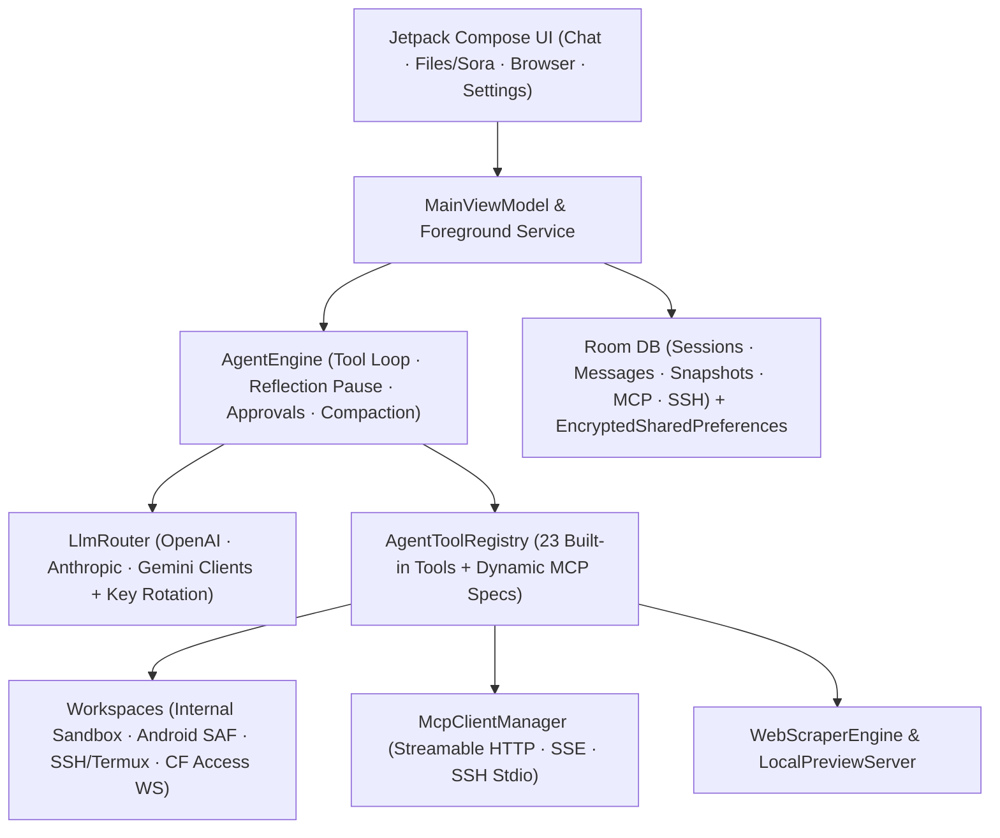

<div align="center">

# ForgeMind

**Autonomous AI Engineering Agent & Multi-Provider Workspace Client for Android**

[-f59e0b?style=for-the-badge)](https://github.com/DIIIUA/ForgeMind)
[-3ddc84?style=for-the-badge&logo=android&logoColor=white)](#tech-stack)
[](#tech-stack)
[](#interface--workspaces)

*A native mobile command center for reasoning models, tool-calling loops, multi-environment code editing, SSH/Termux execution, MCP servers, and voice interaction.*

[Overview](#overview) · [Active Development Status](#active-development-status) · [Capabilities](#capabilities) · [Architecture](#architecture) · [Build & Test](#build--test) · [Roadmap](#roadmap)

</div>

---

> [!IMPORTANT]
> **Active Development Notice (WIP):** ForgeMind is under heavy, continuous development. Core agent loops, UI ergonomics, provider integrations, and workspace bridges are evolving rapidly. Expect frequent commits, UI refinements, and occasional breaking changes to local storage schemas or settings structures between builds.

---

## Overview

**ForgeMind** turns an Android device into an autonomous AI workspace rather than a simple chat wrapper. Built natively with Kotlin and Jetpack Compose, it gives LLMs controlled, auditable access to local project sandboxes, Android Storage Access Framework (SAF) folders, Termux/SSH hosts, live web scraping/browsing, and external Model Context Protocol (MCP) servers—all backed by encrypted local credential storage and explicit user approval controls.

### Why ForgeMind?
- **Beyond passive chat:** Agents inspect files, run diffs, execute shell commands, start background jobs, browse rendered web pages, and attach generated artifacts back into the conversation.
- **Built for real mobile workflows:** Switch seamlessly between an isolated internal sandbox, an Android SAF directory, or local/remote SSH hosts (including Cloudflare Access WebSocket SSH tunnels).
- **Provider & model freedom:** Connect directly to 13 provider presets or any custom OpenAI-compatible / LiteLLM endpoint with multi-key rotation and per-provider thinking budgets.
- **Safety & determinism:** Every file mutation can capture a rollback snapshot, risky operations pause for inline diff approval, and long tool chains enforce periodic reflection pauses.

---

## Active Development Status

ForgeMind is **actively being built and tested on real Android hardware**. Current engineering focus:

- [x] **Multi-provider streaming & reasoning loop** with key rotation and thinking/budget toggles
- [x] **Tool execution engine** across Internal Sandbox, Android SAF, Termux/SSH (JSch), and Cloudflare Access WS tunnels
- [x] **MCP client support** (`STREAMABLE_HTTP`, `HTTP_SSE`, `SSH_STDIO`) with paginated tool discovery
- [x] **Forced periodic reflection (`thinkEveryToolCalls`)** & turn/context compaction guards
- [x] **Compose compiler metrics & `benchmark` profileable build** for UI performance tuning
- [ ] **Ongoing UI/UX polish:** tighter Compose screen performance, dropdown ergonomics, and adaptive layouts
- [ ] **Expanded device testing & release packaging:** automated instrumentation checks, signed release configuration, and localization cleanup (UI strings are currently primarily in Russian with English technical labels)

---

## Capabilities

### 1. Multi-Provider LLM Router & Reasoning
Supports native wire protocols (`OPENAI_COMPAT`, `ANTHROPIC`, `GEMINI`) out of the box across 13 provider presets:

| Provider Presets | Highlights |
| :--- | :--- |
| **OpenAI / Anthropic / Google Gemini** | Direct SSE streaming, native tool calling, configurable reasoning / thinking budgets |
| **OpenRouter / Groq / xAI Grok / Mistral** | Fast LPU inference, model catalog fetching, unified OpenAI-compatible streaming |
| **Venice AI / NVIDIA NIM / Cloudflare Workers AI / HuggingFace** | Open-weights & specialized inference endpoints |
| **Ollama & Custom OpenAI / LiteLLM** | Local LAN / Termux / tunneled models with custom HTTP headers JSON |

- **API Key Rotation:** Add multiple API keys per provider with automatic rotation on quota/rate errors.
- **Dropdown Model & Provider Selection:** Searchable/compact dropdown selector directly in Chat and Provider Settings.
- **Context Compactor:** Automatic conversation summarization (`compactThresholdPercent`, default `78%`) to keep long coding sessions within context limits.

### 2. Autonomous Agent Engine & 23 Built-In Tools
Runs inside a dedicated lifecycle-aware `AgentForegroundService` (`dataSync`) so multi-step engineering tasks survive backgrounding:

<details>
<summary><strong>Click to expand the built-in toolset & safety controls</strong></summary>

- **Environment & Files (`internal`, `termux_ssh`, `saf`):**
  `check_environment_status`, `list_files`, `search_files`, `search_codebase` (grep), `file_read` (with line offsets & PDF parsing via `pdfbox-android`), `file_write`, `file_edit` (exact string replacement with unified diff), `file_delete`, `create_folder`, `archive_create`, `archive_extract`, `transfer_file`, `send_file_to_chat`
- **Shell & Background Processes (SSH / Termux / Local):**
  `run_command`, `run_command_async` (returns PID + log path), `check_command_status`, `kill_command`
- **Web Search, Scraping & Browser Control:**
  `web_search` (DuckDuckGo, Tavily, Brave, Google CSE, or custom SearXNG), `web_scrape` (`markdown`, `text`, `selector`, `links`, `tables`, `html`, optional JS rendering via WebView), `browser_open`
- **MCP Integration:**
  `mcp_list_servers`, `mcp_connect`, `mcp_call_tool`, `mcp_read_resource` + dynamically registered tools from enabled MCP servers
- **Safety & Guardrails:**
  - Interactive **Pending Approval** cards with diff previews (`autoApproveSafe` / `autoApproveAll` toggles)
  - Automatic pre-edit **File Snapshots** stored in Room (`FileSnapshotEntity`) for rollback
  - **Max Turn Guard** (`maxTurns`, default `100`)
  - **Forced Reflection Loop** (`thinkEveryToolCalls`, default `25`): pauses tool execution every N calls to force re-evaluation before continuing

</details>

### 3. Interface & Workspaces
The app is organized into four core Compose tabs (`AppSection`):

1. **Chat:** Streaming Markdown/code responses, collapsible reasoning blocks, inline tool execution cards, file/image/PDF attachments, Android `ACTION_SEND` share target support, chat folders, Markdown export, and full ZIP archive backup/restore.
2. **Files & Code Workspace:** Multi-environment explorer (`internal`, `termux_ssh`, `saf`) paired with **Sora Editor** and TextMate syntax highlighting (`Kotlin`, `Java`, `Python`, `JavaScript`, `TypeScript`, `HTML`, `CSS`, `JSON`, `XML`, `Lua`, `Markdown`) plus 5 editor themes (`ayu-dark`, `darcula`, `quietlight`, `solarized_dark`).
3. **Browser & Live Preview:** Built-in WebView browser (`PreviewScreen`) coupled with an embedded loopback HTTP `LocalPreviewServer` for previewing HTML/CSS/JS workspaces generated by the agent.
4. **Settings:** Provider configs, MCP server registry, SSH/SFTP profiles (including **Cloudflare Access Service Token WebSocket SSH tunneling**), search engines, voice pipeline, and agent loop parameters.

### 4. Voice Loop (STT & TTS)
- **Speech-to-Text (STT):** Groq Whisper (`whisper-large-v3-turbo`), OpenAI Whisper, custom Whisper endpoints, or offline Android `SpeechRecognizer` (with an optional cloud ↔ offline auto-fallback toggle in Settings).
- **Text-to-Speech (TTS):** Local/tunneled XTTS v2, OpenAI / compatible TTS (`gpt-4o-mini-tts`), or built-in Android TTS—with playback speed control, pitch/tempo options, optional auto-speak, and automatic code-block skipping (`skipCodeInTts`).

---

## Architecture



<details>
<summary><strong>Project Structure (`app/src/main/java/com/forgemind/app`)</strong></summary>

```text
app/src/main/java/com/forgemind/app/
├── agent/       # AgentEngine, AgentTools, AgentForegroundService
├── bridge/      # WorkspaceManager, ArchiveUtils, TermuxBridge, TerminalSessionManager, CloudflareAccessSshSupport, DiffUtils
├── data/
│   ├── archive/ # ChatArchiveManager (Markdown export, ZIP backup/restore)
│   ├── db/      # Room database (v3 exported schemas), Entities, DAOs
│   ├── model/   # Provider presets, Settings, Tool cards, Attachments
│   └── prefs/   # DataStore + AES256_GCM EncryptedSharedPreferences
├── llm/         # LlmRouter, OpenAiCompatibleClient, AnthropicClient, GeminiClient, ContextCompactor, ModelScanner
├── mcp/         # McpClientManager (Streamable HTTP, HTTP+SSE, SSH Stdio)
├── ui/          # MainViewModel, ChatScreen, FilesScreen, PreviewScreen, SettingsScreen, ModelSelectorButton, Previews
├── voice/       # AudioRecorder, SttManager, TtsManager
└── web/         # WebScraperEngine, LocalPreviewServer
```

</details>

---

## Tech Stack

- **Language & Build:** Kotlin `2.2.21`, Android Gradle Plugin `8.13.2`, KSP `2.2.21-2.0.5`, Java `17` + core library desugaring
- **UI:** Jetpack Compose BOM `2025.09.00`, Material 3, Navigation Compose, Coil `2.7.0`, Sora Editor `0.23.6` (TextMate)
- **Persistence & Security:** Room `2.8.5`, DataStore Preferences, `androidx.security:security-crypto` (`AES256_GCM` for API keys and SSH secrets)
- **Networking & Transport:** OkHttp `4.12.0` + SSE + WebSockets, `mwiede/jsch` `2.28.8` (SSH/SFTP), Jsoup `1.20.1`, PDFBox Android `2.0.27.0`

---

## Build & Test

### Prerequisites
- Android Studio / Android SDK (`compileSdk 36`, `minSdk 29`)
- JDK 17

### Setup & Commands
1. Set `ANDROID_HOME` (or add `sdk.dir=<path-to-android-sdk>` to `local.properties`).
2. Run all unit tests and build the debug APK:
   ```bash
   ./gradlew testDebugUnitTest assembleDebug
   ```
3. *(Optional)* Build the profileable benchmark variant for Compose/systrace profiling:
   ```bash
   ./gradlew assembleBenchmark
   ```

> [!NOTE]
> No API keys, server addresses, or credentials are bundled in this repository. All provider keys, SSH secrets, and MCP tokens are configured locally by the user on the device and stored in encrypted preferences.

### Included Unit Test Suites (`app/src/test`)
- `AgentReflectionLoopTests` — forced reflection loop triggers, persistence defaults, and settings clamping
- `CloudflareAccessSshTests` — WebSocket SSH tunnel framing and header validation
- `ForgeMindCoreTests` — core state, diffing, and provider routing checks
- `McpDiscoveryAndMediaTests` — MCP pagination, catalog inspection, and media attachment handling
- `TtsSpeedAndChunkTests` — TTS playback speed bounds and chunking behavior

---

## Roadmap

- Full English/multilingual UI string extraction (`strings.xml`) alongside existing Russian labels
- Additional instrumentation & Compose UI regression tests
- Release minification/ProGuard rules & signed release workflow
- Extended provider diagnostics and visual workspace diff browser

---

<div align="center">
<sub>ForgeMind is actively evolving — feedback, ideas, and issue reports are welcome as development continues.</sub>
</div>
