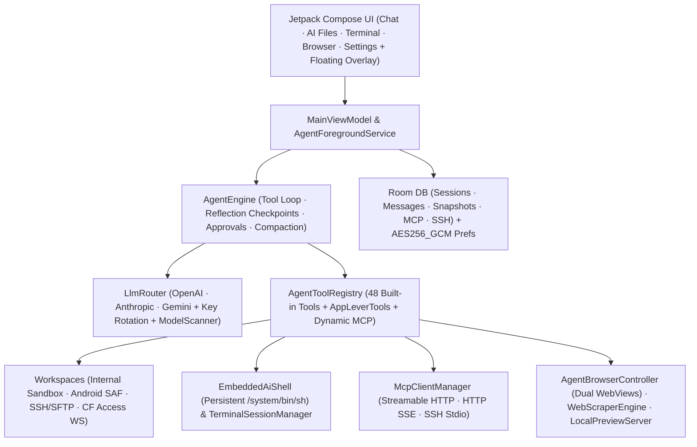

<div align="center">

# ForgeMind

**Autonomous AI Engineering Agent & Multi-Provider Workspace Client for Android**

[](https://github.com/DIIIUA/ForgeMind)
[-3ddc84?style=for-the-badge&logo=android&logoColor=white)](#tech-stack)
[](#tech-stack)
[](#interface--workspaces)

**Languages:** **English** · [Русский](README.ru.md)

*A native mobile command center for reasoning models, autonomous tool-calling loops, multi-environment code & document workspaces, embedded local + SSH/Termux shells, MCP servers, floating chat overlay, and voice interaction.*

[Overview](#overview) · [Highlights](#highlights) · [Capabilities](#capabilities) · [Architecture](#architecture) · [Build & Test](#build--test) · [Localization (14 Languages)](#localization-14-languages)

</div>

---

## Overview

**ForgeMind** turns an Android device into a full-featured autonomous AI engineering workspace rather than a passive chat wrapper. Built natively with Kotlin and Jetpack Compose, it gives LLMs controlled, auditable access to an isolated local sandbox, Android Storage Access Framework (SAF) folders, an always-available embedded `/system/bin/sh` shell, Termux/SSH hosts, dual isolated WebViews, and external Model Context Protocol (MCP) servers—backed by encrypted local credential storage and granular user approval controls.

## Highlights

- **5-Tab Mobile Command Center:** `Chat`, `AI Files`, `Terminal`, `Browser`, and `Settings`, plus a draggable **Floating Chat Overlay** (`SYSTEM_ALERT_WINDOW`) with a bottom-left resize grip positioned away from the Send button.
- **Resilient Dual-Mode Terminal & Embedded AI Shell:** Dedicated **Watch Agent (Live)** and **Manual** terminal modes backed by `EmbeddedAiShell`—a persistent `/system/bin/sh` process inside the app sandbox that preserves working directory (`cd`) and environment variables (`export`), and automatically serves as a live fallback whenever Termux or remote SSH disconnects.
- **In-App File, Media & Office Viewer:** Open and inspect images (`PNG`, `JPG`, `WEBP`, `GIF`, `BMP`, `HEIC`), `PDF` files, Office/OpenDocument files (`DOCX`, `XLSX`, `PPTX`, `ODT`, `ODS`, `ODP`, `RTF`), `ZIP`/`JAR`/`APK` archives, rendered Markdown, and syntax-highlighted source code directly inside **AI Files** and chat attachments.
- **Full Multi-Provider & Venice AI Catalog Discovery:** Native streaming across `OPENAI_COMPAT`, `ANTHROPIC`, and `GEMINI` wire protocols for 13 provider presets—including full Venice AI catalog discovery (`/models?type=all` across text, code, image, TTS, ASR, embedding, and video models) with category filter chips and instant search.
- **14 UI Languages Built In:** English default resources (`res/values/strings.xml`) with instant in-app switching across 14 locales without restarting Android.

---

## Capabilities

### 1. Multi-Provider LLM Router & Model Discovery
Supports native wire protocols (`OPENAI_COMPAT`, `ANTHROPIC`, `GEMINI`) out of the box across 13 provider presets:

| Provider Presets | Highlights |
| :--- | :--- |
| **OpenAI / Anthropic / Google Gemini** | Direct SSE streaming, native tool calling, configurable reasoning / thinking budgets |
| **OpenRouter / DeepSeek / Groq / xAI Grok / Mistral** | Fast inference, automatic model catalog scanning, unified OpenAI-compatible streaming |
| **Venice AI** | Full multi-modal `/models?type=all` catalog discovery (`text`, `code`, `image`, `tts`, `asr`, `embedding`, `video`), `model_spec` context & beta metadata, category filter chips |
| **NVIDIA NIM / Cloudflare Workers AI / HuggingFace** | Open-weights & specialized inference endpoints |
| **Ollama & Custom OpenAI / LiteLLM** | Local LAN / Termux / tunneled models with custom HTTP headers JSON and DNS-over-HTTPS fallback |

- **API Key Rotation:** Store multiple API keys per provider with automatic failover on `429` / quota errors.
- **Context Compactor:** Automatic conversation summarization (`compactThresholdPercent`, default `78%`) that preserves tool-call boundaries (`safeCompactionSplitIndex`).

### 2. Autonomous Agent Engine & 48 Built-In Tools
Runs inside a lifecycle-aware `AgentForegroundService` (`dataSync`) so multi-step engineering tasks continue reliably in the background:

<details>
<summary><strong>Click to expand all 48 built-in tools & safety controls</strong></summary>

- **Environment, Files & Rollback Snapshots (`internal`, `termux_ssh`, `saf`):**
  `check_environment_status`, `list_files`, `search_files`, `search_codebase` (regex grep), `file_info`, `file_read` (with line offsets & PDF text extraction via `pdfbox-android`), `file_write`, `file_edit` (exact replacement + unified diff), `file_move`, `file_delete`, `create_folder`, `archive_create`, `archive_extract`, `transfer_file`, `send_file_to_chat`, `snapshot_list`, `snapshot_restore`
- **Embedded Shell, SSH & Visible Terminal Tabs:**
  `run_command` (SSH/Termux with automatic fallback to persistent embedded `/system/bin/sh`), `run_command_async` (background PID + log path), `check_command_status`, `kill_command`, `terminal_list_tabs`, `terminal_open_tab`, `terminal_send`
- **Dual Isolated WebViews, Web Search & Local Preview Server:**
  `web_search` (DuckDuckGo, Tavily, Brave, Google CSE, or SearXNG), `web_scrape`, `browser_open`, `browser_agent_mode`, `browser_agent_navigate`, `browser_agent_inspect` (DOM + indexed interactive elements + JS console errors), `browser_agent_act` (`click`, `type`, `scroll`, `wait`, `back`, `forward`, `reload`, `clear`), `browser_agent_eval_js`, `browser_agent_screenshot`, `preview_server_control`
- **Code Editor, Chat Workspace, Navigation & Voice:**
  `editor_open_file`, `editor_list_tabs`, `chat_list_sessions`, `chat_search_history`, `chat_read_session`, `chat_manage`, `chat_export_markdown`, `context_compact`, `app_navigate`, `voice_speak`
- **Model Context Protocol (MCP):**
  `mcp_list_servers`, `mcp_connect`, `mcp_call_tool`, `mcp_read_resource` + dynamic registration of tools from enabled MCP servers (`STREAMABLE_HTTP`, `HTTP_SSE`, `SSH_STDIO`), `initialize.instructions` prompt injection, Code Mode / gateway catalog detection, and binary image attachment forwarding (`PNG`/`WEBP`/`JPEG`).
- **Granular Guardrails:**
  - Category-level auto-approval toggles (safe reads/writes, file deletion, shell commands, browser JS, MCP calls), explicit tool allowlists/blocklists, and destructive shell command interception (`rm -rf`, `mkfs`, etc.)
  - Automatic pre-edit **File Snapshots** (`FileSnapshotEntity`) for instant one-tap or agent-driven rollback
  - **Max Turn Guard** (`maxTurns`, default `100`) & **Forced Reflection Checkpoints** (`thinkEveryToolCalls`, default `25`)

</details>

### 3. Interface & Workspaces
The app is organized into five main Compose tabs (`AppSection`) plus an optional system-wide overlay:

1. **Chat:** Streaming Markdown & code blocks, collapsible reasoning trace, inline tool execution & diff approval cards, **Retry** / **Edit** message controls, multi-file/image/document attachments, Android `ACTION_SEND` share target support, chat folders, Markdown export, and full ZIP archive backup/restore.
2. **AI Files (`internal`, `saf`, `termux_ssh`):**
   - **AI Home (`internal`):** App-private sandbox workspace (`/data/data/com.forgemind.app/files/workspaces/<project>`).
   - **Android Folder (`saf`):** User-granted shared storage directory via Android Storage Access Framework (`ACTION_OPEN_DOCUMENT_TREE`), enabling safe collaboration on shared folders (such as `Download`, `Documents`, or project trees) without broad storage permissions.
   - **Termux / SSH (`termux_ssh`):** SFTP/SSH explorer across local Termux (`port 2222`) or remote Linux servers (including **Cloudflare Access Service Token WebSocket SSH tunnels**).
   - **Built-in Viewers & Sora Editor:** View images (pinch-to-zoom), PDFs, `DOCX`/`XLSX`/`PPTX`/`ODT`/`ODS`/`ODP`/`RTF` documents, `ZIP` archive trees, rendered Markdown, or edit code in **Sora Editor** with TextMate grammars and 5 themes.
3. **Terminal:**
   - **Watch Agent (Live):** Real-time stream of commands and outputs executed by the agent across `EmbeddedAiShell` and SSH/Termux, with quick switch to manual input.
   - **Manual:** Interactive multi-tab SSH/Termux sessions and direct commands in the persistent local `/system/bin/sh` sandbox shell, complete with a quick-key row (`ESC`, `TAB`, `CTRL+C`, arrows, snippets).
4. **Browser:** Dual isolated `WebView` instances—a private **Regular** browser for the user and a dedicated **Agent (Live)** WebView (`agentWebView`) with live action banners, DOM inspector, JS console drawer, and loopback HTTP `LocalPreviewServer` for previewing generated web apps.
5. **Settings:** Language selector (14 languages), floating chat overlay toggle, provider & key management, MCP server registry, SSH/SFTP & Cloudflare Access profiles, search engines, voice pipeline, and granular approval rules.

### 4. Voice Loop (STT & TTS)
- **Speech-to-Text (STT):** Groq Whisper (`whisper-large-v3-turbo`), OpenAI Whisper, custom Whisper endpoints, or offline Android `SpeechRecognizer` (with optional cloud ↔ offline automatic fallback).
- **Text-to-Speech (TTS):** Local or external XTTS v2 streaming, OpenAI / compatible TTS (`gpt-4o-mini-tts`), or Android System TTS—with live playback speed control, pitch/tempo settings, and automatic code-block stripping (`skipCodeInTts`).

---

## Localization (14 Languages)

ForgeMind ships with complete English default resources (`res/values/strings.xml`) and localized UI translations selectable at runtime in **Settings → App Language**:

`System default` · `English` · `Русский` · `Español` · `中文 (简体)` · `العربية` · `हिन्दी` · `Português` · `Français` · `Deutsch` · `日本語` · `한국어` · `Türkçe` · `Українська`

---

## Architecture



<details>
<summary><strong>Project Structure (`app/src/main/java/com/forgemind/app`)</strong></summary>

```text
app/src/main/java/com/forgemind/app/
├── agent/       # AgentEngine, AgentTools, AppLeverTools, AgentForegroundService
├── bridge/      # WorkspaceManager, EmbeddedAiShell, InAppDocumentParser, ArchiveUtils, TermuxBridge, TerminalSessionManager, CloudflareAccessSshSupport, DiffUtils
├── data/
│   ├── archive/ # ChatArchiveManager (Markdown export, ZIP backup/restore)
│   ├── db/      # Room database (exported schemas), Entities, DAOs
│   ├── model/   # DomainModels, Provider presets, Settings, Tool cards, Attachments
│   └── prefs/   # DataStore + AES256_GCM EncryptedSharedPreferences
├── floating/    # FloatingChatService (draggable overlay bubble & resizable mini-chat window)
├── i18n/        # LocaleHelper & 14-language AppLanguage configuration
├── llm/         # LlmRouter, OpenAiCompatibleClient, AnthropicClient, GeminiClient, ContextCompactor, ModelScanner
├── mcp/         # McpClientManager (Streamable HTTP, HTTP+SSE, SSH Stdio)
├── ui/          # MainViewModel, ChatScreen, FilesScreen, DocumentContentViewer, TerminalScreen, PreviewScreen, SettingsScreen, ModelSelectorButton
├── voice/       # AudioRecorder, SttManager, SttFallbackPolicy, TtsManager
└── web/         # AgentBrowserController, WebScraperEngine, LocalPreviewServer
```

</details>

---

## Tech Stack

- **Language & Build:** Kotlin `2.2.21`, Android Gradle Plugin `8.13.2`, KSP `2.2.21-2.0.5`, Java `17` + core library desugaring
- **UI:** Jetpack Compose BOM `2025.09.00`, Material 3, AppCompat per-app locales, Navigation Compose, Coil `2.7.0`, Sora Editor `0.23.6` (TextMate)
- **Persistence & Security:** Room `2.8.5`, DataStore Preferences, `androidx.security:security-crypto` (`AES256_GCM` for API keys and SSH secrets)
- **Networking & Parsing:** OkHttp `4.12.0` (SSE + WebSockets + DoH fallback), `mwiede/jsch` `2.28.8` (SSH/SFTP), Jsoup `1.20.1`, PDFBox Android `2.0.27.0`

---

## Build & Test

### Prerequisites
- Android Studio / Android SDK (`compileSdk 36`, `minSdk 29`)
- JDK 17

### Commands
1. Set `ANDROID_HOME` (or add `sdk.dir=<path-to-android-sdk>` in `local.properties`).
2. Run all unit test suites and assemble the debug APK:
   ```bash
   ./gradlew testDebugUnitTest assembleDebug
   ```
3. *(Optional)* Assemble the profileable benchmark build:
   ```bash
   ./gradlew assembleBenchmark
   ```

> [!NOTE]
> Zero API keys, private server addresses, or credentials are bundled in this repository. All provider keys, SSH credentials, and MCP headers are configured locally on the device and stored in `AES256_GCM` encrypted preferences.

### Unit Test Suites (`app/src/test`)
- `AgentReflectionLoopTests` — forced reflection checkpoints, `[[TASK_DONE]]` handling, wire history flattening, and settings migration
- `AppLeverToolsTests` — 48 built-in tool schema verification, URL normalization, JS string decoding, and approval invariants
- `ArchiveUtilsTests` — ZIP creation/extraction roundtrips and Zip-Slip path traversal protection
- `CloudflareAccessSshTests` — WebSocket SSH binary framing, Cloudflare Access header injection, and `302` auth failure surfacing
- `ForgeMindCoreTests` — OpenAI/Venice routing & `?type=all` model scanning, bottom-left overlay resize math, `InAppDocumentParser` (`DOCX`/`XLSX`/`PPTX`/`RTF`/`ZIP`), `EmbeddedAiShell`, `AppLanguage`, DoH, and XTTS streaming
- `McpDiscoveryAndMediaTests` — paginated MCP discovery, Code Mode detection, binary `WEBP`/`PNG` tool attachments, and clean public prompt hygiene
- `SttFallbackPolicyTests` — cloud ↔ offline speech recognition fallback rules
- `TtsSpeedAndChunkTests` — XTTS/OpenAI speed clamping, sentence-aware chunking, and mid-stream disconnect retry
- `Wave1RegressionTests` — orphan tool recovery, safe compaction splits, granular tool approvals, and passive background UI levers
