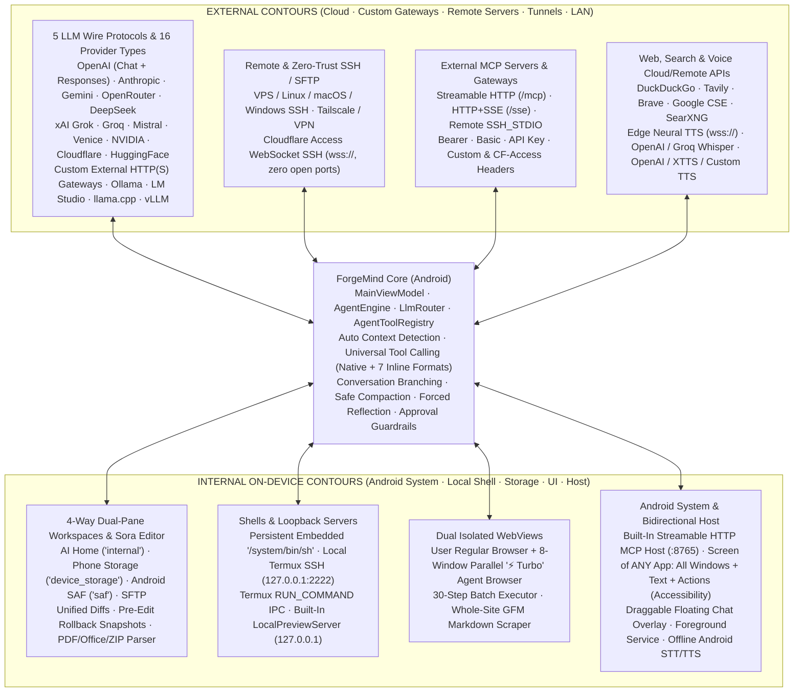

<div align="center">

# ForgeMind

**Autonomous AI Engineering Workstation & Universal Internal/External Connection Hub for Android**

[&color=10b981)](https://github.com/DIIIUA/ForgeMind/releases/latest)
[](https://github.com/DIIIUA/ForgeMind/actions/workflows/android-ci.yml)
[](LICENSE)
[-3ddc84?style=for-the-badge&logo=android&logoColor=white)](#install--build)
[](#tech-stack)

**Languages:** **English** · [Русский](README.ru.md) · [**Full Graphify Architecture Map (1,571 Nodes · 3,586 Edges)**](docs/GRAPHIFY_ARCHITECTURE.md)

*A native Kotlin + Jetpack Compose command center uniting **every external and internal connection contour** on Android: frontier cloud APIs, custom external HTTP/HTTPS gateways, self-hosted & LAN servers, Cloudflare Zero-Trust WebSocket SSH (`wss://`), remote & Termux SSH/SFTP, bidirectional MCP (`Streamable HTTP` · `SSE` · `SSH stdio` + built-in Android MCP Host), 4-way file workspaces with Sora code editing & rollback snapshots, an 8-window `⚡ Turbo` Agent Browser, reading and operating the screen of any Android app across all open windows (Window-Tag DOM), floating system overlay, and multi-engine neural voice.*

[**⬇ Download Ready-to-Install `.apk` (GitHub Releases)**](https://github.com/DIIIUA/ForgeMind/releases/latest) · [External & Internal Connection Matrix](#universal-connection-matrix-external--internal) · [All 56 Built-In Tools + Dynamic MCP](#56-built-in-tools--bidirectional-mcp) · [1-Minute Setup Guides](#1-minute-setup-guides) · [Graphify Map](docs/GRAPHIFY_ARCHITECTURE.md) · [License](#license--commercial-rights)

</div>

---

## Interface Showcase

| Autonomous Chat & Diff Cards | Dual-Pane Files & Sora Editor | Live Shell & Agent Browser | Contextual Setup Guides & MCP |
| :---: | :---: | :---: | :---: |
|  |  |  |  |

---

## Universal Connection Matrix (External ↔ Internal)

Unlike single-purpose mobile chat clients, **ForgeMind** is architected as a **dual-contour (External + Internal) hub** that accepts and bridges every major AI, shell, filesystem, web, voice, and tool protocol—without bundling a multi-gigabyte Linux container inside the APK:



### 1. External Connections & Protocols
- **5 Native LLM Wire Protocols (`WireProtocol`):**
  - `OPENAI_COMPAT` (streaming SSE `/chat/completions` + non-SSE fallback)
  - `OPENAI_RESPONSES` (native OpenAI `/responses` API)
  - `ANTHROPIC` (native Anthropic `/v1/messages` SSE with thinking blocks)
  - `GEMINI` (native Google Gemini `streamGenerateContent` SSE)
  - `OLLAMA_NATIVE` (native `/api/chat` NDJSON + `/api/show` metadata)
- **All AI Provider Classes (`CLOUD` · `CUSTOM` · `LOCAL_LAN`):**
  - **12+ Cloud Presets:** OpenAI, Anthropic, Google Gemini, OpenRouter, DeepSeek, xAI Grok, Groq, Mistral, Venice AI (full `/models?type=all` catalog + `model_spec`), NVIDIA NIM, Cloudflare Workers AI, HuggingFace.
  - **Custom External AI Endpoints (`CUSTOM`):** connect any corporate proxy, LiteLLM gateway, tunnel, or custom REST/SSE server (`#` raw endpoint suffix support), **6 auth modes** (`AUTO`, `NONE`, `BEARER`, `X_API_KEY`, `QUERY_KEY`, `CUSTOM_HEADER` with custom prefix), arbitrary JSON headers & extra request body JSON, optional self-signed TLS (`allowInsecureSsl`), automatic **DNS-over-HTTPS (DoH)** fallback, live online/offline status indicators, and multi-key rotation on `429/401/402/403`.
  - **Self-Hosted, Tailscale & LAN Servers (`LOCAL_LAN`):** targeted 1-second host probe (**Find by Address** / **Connect Directly**) plus parallel `/24` subnet discovery for Ollama, LM Studio, `llama.cpp`, KoboldCpp, vLLM, SGLang, LocalAI, Jan, GPT4All, OpenWebUI, and LiteLLM.
- **Remote SSH, SFTP & Cloudflare Zero-Trust Tunnels:**
  - Connect to any remote Linux/macOS/Windows machine over password or OpenSSH/PEM private key via public IP, VPN, or Tailscale.
  - Built-in **Cloudflare Access WebSocket SSH (`wss://`)** (`CloudflareAccessSshSupport`): tunnel SSH/SFTP directly through Cloudflare Zero Trust using `CF-Access-Client-Id` / `CF-Access-Client-Secret` with **zero open firewall ports** and **no external binary** on Android.
- **Outbound MCP Client (3 Transports):**
  - `STREAMABLE_HTTP` (MCP 2025-03-26 `POST /mcp`, session headers, paginated tool discovery, `initialize.instructions` injection, Code Mode gateway detection, binary `PNG`/`WEBP`/`JPEG` attachment forwarding)
  - `HTTP_SSE` (dual-channel SSE MCP)
  - `SSH_STDIO` (spawns CLI MCP servers such as `npx`, `uvx`, or `python3` directly inside remote SSH hosts or local Termux)
- **External Search & Multi-Provider Voice APIs:**
  - **5 Web Search Engines:** DuckDuckGo (zero-key), Tavily, Brave Search, Google CSE, and custom/self-hosted **SearXNG**.
  - **Cloud & Remote Voice:** free **Microsoft Edge Neural TTS (`wss://`)**, **Groq Whisper**, **OpenAI Whisper**, **Custom Whisper** endpoints, **OpenAI TTS**, **XTTS v2** (local or external server).

### 2. Internal On-Device Contours & Incoming Host Connections
- **4 Simultaneous File Workspaces + Dual-Pane Split View:**
  - **AI Home (`internal`)** app sandbox · **Phone Storage (`device_storage`)** shared storage · **Android Folder (`saf`)** via Storage Access Framework · **SFTP (`termux_ssh`)**.
  - Copy or move files across any two environments in split-pane UI or via agent `transfer_file`, inspect/create `ZIP` archives, read `PDF` (`pdfbox-android`) and `DOCX`/`XLSX`/`PPTX`/`ODT`/`ODS`/`ODP`/`RTF` (`InAppDocumentParser`), and edit code in **Sora Editor (TextMate)** with unified diffs and automatic pre-edit **Rollback Snapshots**.
- **Persistent Embedded Shell + Termux Integration + Loopback HTTP Server:**
  - **Embedded AI Shell (`EmbeddedAiShell`):** persistent on-device `/system/bin/sh` preserving `cwd` and environment variables, running out of the box and acting as an automatic failover if SSH drops.
  - **Local Termux Contour:** connects via `127.0.0.1:2222` SSH/SFTP and Android `com.termux.permission.RUN_COMMAND` broadcasts (`TermuxResultReceiver`), alongside a multi-tab **Watch Agent (Live) / Manual** terminal with customizable color palettes.
  - **`LocalPreviewServer`:** built-in loopback HTTP server (`http://127.0.0.1:<port>`) serving web projects directly into the in-app browser.
- **Built-In Android MCP Host Server (`ForgeMcpHostServer`):**
  - Exposes ForgeMind's internal tools over a local `Streamable HTTP` MCP endpoint (`127.0.0.1:8765`, `/mcp` & `/health`, constant-time `Bearer` token auth, granular write/shell toggle) for on-device clients, Termux agents, `adb forward`, or secure tunnels.
- **Dual Isolated WebViews & 8-Window `⚡ Turbo` Agent Browser:**
  - Completely separates the user's **Regular Browser** from the AI's **8-window background WebView pool** (`AgentBrowserController`) with vertical collapsible tab switcher, ad/tracker/font blocking, 30-step `browser_agent_batch` execution, and whole-site GFM Markdown crawling (`web_scrape_site`).
- **Real-Time Android Window-Tag DOM & Floating System Overlay:**
  - **Accessibility Engine (`ForgeAccessibilityService`) — sees and operates any app on screen, not just ForgeMind:**
    - **Reads the screen content of any third-party app** as structured text instead of guessing from screenshots: every visible label, message, list item, field value and content description, plus interactive elements — turned into numbered tags `[#1..#k]` (`screen_read_windows`, full visible text by default, `only_interactive=true` to narrow down).
    - **Navigates across all windows at once** `[W1..Wn]`: the foreground app, split-screen halves (with divider), floating / pop-up windows, the on-screen keyboard (IME) and system panels; detects which app is actually in the foreground (with workarounds for HyperOS / MIUI overlays) and can filter by package or window title. ForgeMind's own floating window is hidden from the snapshot unless `include_self=true`.
    - **Acts inside those apps:** tap / long-press / type or append Unicode text / scroll by tag, tap by visible label or `x,y`, swipes, `wait_text` until something appears, `open_app`, and global Back / Home / Recents / Notifications / Quick Settings — single actions (`screen_act_tag`) or whole chains in one call without round-trips (`screen_act_batch`).
    - **On-demand hardware screenshots** (`screen_capture`, Android 11+, `webp`/`jpeg`/`png`, optionally together with the tag tree) — no background recording.
    - *Optional and user-controlled:* works only after you enable the ForgeMind Accessibility service in Android settings. Android itself hides password field contents, and apps that set `FLAG_SECURE` block screenshots.
  - **Floating Overlay (`FloatingChatService`) & `AgentForegroundService`:** draggable bubble and resizable mini-chat window with voice input over any Android app, keeping long engineering runs alive in the background.

### 3. Everyday Workspace Features (found by the Graphify coverage audit)
- **Chat:** non-destructive message branching (`< 1/2 >`), edit & resend, per-model reasoning effort (`OFF` / `LOW` / `MEDIUM` / `HIGH`) with a collapsible "model thinking" block, live context-usage bar, rich Markdown rendering (tables, code blocks with copy, inline images), fullscreen image zoom & download, and file/image attachments from AI Home or any Android picker.
- **Share into ForgeMind:** send text, images, or PDFs from any Android app straight into a chat via the system Share sheet.
- **Session drawer:** search across chats, folders, pin / archive, per-chat instructions (`⋮` menu), Markdown export, and full ZIP backup / restore of all chats.
- **Terminal:** multiple tabs in local `/system/bin/sh` or interactive SSH PTY mode, "Watch Agent (Live)" vs. "Manual" view, quick-key chips (Ctrl+C, Tab, Esc, ↑ history, copy / clear output), quick command presets, and color palettes for background / text / prompt.
- **Floating overlay:** three modes over any app — compact bubble, slim live ticker of what the agent is doing, and a resizable mini-chat card with voice input.
- **Theme Studio:** colors and opacity per UI component (background, surface, cards, accent, user / AI messages, borders) plus 14 interface languages.
---

## Universal Tool Calling & Auto Context Across Every Model

Whether you connect a frontier cloud reasoning model, a corporate custom gateway, or a `7B–9B` quantized/uncensored local GGUF model:
1. **Live Context Window Auto-Detection + 1-Tap Override:** automatically probes server metadata (`/v1/models`, LM Studio `/api/v0/models` `loaded_context_length`, `llama.cpp` `/props` `n_ctx`, Ollama `/api/show` `num_ctx`) with smart fallback heuristics, and provides instant `Auto | 4K | 8K | 16K | 32K | 64K | 128K | 200K | 256K | 1M | Custom…` chips right inside the chat model picker.
2. **Adaptive Schema Sizing & Multi-Format Tool Parser:** keeps full tool & MCP schemas for large-context models while automatically switching constrained models to a compact core toolset (retaining full MCP reach via `mcp_call_tool`), parsing **7 inline tool-call formats** (`<tool_call>`, DeepSeek `<｜tool▁calls▁begin｜>`, DSML, `<function=...>`, `<invoke>`, `[TOOL_CALLS]`, Pythonic calls + single-quoted dict repair), auto-downgrading wire history on `HTTP 400/404/422/500` template errors, and self-correcting unexecuted ```bash``` blocks.

---

## 56 Built-In Tools + Bidirectional MCP

<details>
<summary><strong>Click to expand all 56 built-in agent tools (`29` Core + `27` App Levers) & safety guardrails</strong></summary>

- **4-Way Workspaces, Archives & Rollback Snapshots (17):**
  `check_environment_status`, `list_files`, `search_files`, `search_codebase`, `file_info`, `file_read`, `file_write`, `file_edit`, `file_move`, `file_delete`, `create_folder`, `archive_create`, `archive_extract`, `transfer_file`, `send_file_to_chat`, `snapshot_list`, `snapshot_restore`
- **Embedded Shell, SSH/Termux & Terminal Tabs (7):**
  `run_command`, `run_command_async`, `check_command_status`, `kill_command`, `terminal_list_tabs`, `terminal_open_tab`, `terminal_send`
- **8-Window `⚡ Turbo` Agent Browser, Web Search, Site Scraper & Preview Server (14):**
  `web_search`, `web_scrape`, `web_scrape_site`, `browser_open`, `browser_agent_tabs`, `browser_agent_navigate`, `browser_agent_inspect`, `browser_agent_markdown`, `browser_agent_act`, `browser_agent_batch`, `browser_agent_eval_js`, `browser_agent_screenshot`, `browser_agent_mode`, `preview_server_control`
- **Real-Time Android Window-Tag DOM (4):**
  `screen_read_windows`, `screen_act_tag`, `screen_act_batch`, `screen_capture`
- **Sora Editor, Chat Branching/History, Compaction, Navigation & Voice (10):**
  `editor_open_file`, `editor_list_tabs`, `chat_list_sessions`, `chat_search_history`, `chat_read_session`, `chat_manage`, `chat_export_markdown`, `context_compact`, `app_navigate`, `voice_speak`
- **Model Context Protocol Bridge + Dynamic Server Tools (4 + Dynamic):**
  `mcp_list_servers`, `mcp_connect`, `mcp_call_tool`, `mcp_read_resource` + automatic direct registration of every tool from enabled MCP servers.
- **Safety, Branching & UX Controls:**
  - Category-level auto-approval toggles, explicit tool allowlists/blocklists, destructive shell interception (`rm -rf`, `mkfs`, etc.), pre-edit file snapshots, `maxTurns` guard, forced reflection checkpoints (`thinkEveryToolCalls`), non-destructive message branching (`< 1/2 >`), compaction confirmation dialog, per-chat instructions (`⋮` drawer menu), minimalist collapsible connection-line indicator strip, **14 interface languages**, and a live per-component **Theme / Design Studio**.

</details>

---

## 1-Minute Setup Guides

- **Cloud or Custom External AI (`Settings → AI Providers`):** select any built-in cloud provider and paste one or more API keys (auto-rotated), or tap **Add Custom External AI** to configure any `http(s)://` endpoint, wire protocol, auth header/query key, and custom JSON headers.
- **Local / LAN / Tailscale AI (`Settings → AI Providers → Find Local AIs in Network`):** enter an `IP:port` or URL and tap **Find by Address** (~1s) or **Connect Directly**, or tap **Scan Full Wi-Fi / LAN**.
- **Termux or Remote / Cloudflare SSH (`Settings → Environments`):**
  - *Local Termux:* run `pkg update -y && pkg install -y openssh && passwd && sshd -p 2222` in Termux, check `whoami`, and save credentials in `Termux (local)` (`127.0.0.1:2222`).
  - *Remote Server / Cloudflare Zero Trust:* enter your server's IP/Tailscale host (or enable **Cloudflare Access tunnel (`wss://`)** with Service Token headers for portless Zero-Trust SSH).
- **External MCP & On-Device MCP Host (`Settings → MCP Servers`):** add `STREAMABLE_HTTP`, `HTTP_SSE`, or `SSH_STDIO` servers—or enable the **Built-In Android MCP Host (`:8765`)**.

---

## Install & Build

- **GitHub Releases:** download `ForgeMind-v0.2.0-alpha.apk` from [**Releases**](https://github.com/DIIIUA/ForgeMind/releases/latest).
- **[Obtainium](https://github.com/ImranR98/Obtainium):** add `https://github.com/DIIIUA/ForgeMind` with *Include prereleases* enabled.
- **Build & Run All 96 Unit Tests from Source:**
  ```bash
  ./gradlew testDebugUnitTest assembleDebug
  ```

> [!NOTE]
> Zero API keys, private server addresses, or personal credentials are bundled in this repository. All secrets are configured locally on your device and encrypted with `AES256_GCM`. See [**docs/GRAPHIFY_ARCHITECTURE.md**](docs/GRAPHIFY_ARCHITECTURE.md) for the complete deterministic AST architecture map (`1,571` nodes, `3,586` edges, `66` communities, `0` import cycles).

---

## Tech Stack

- **Language & Build:** Kotlin `2.2.21`, AGP `8.13.2`, KSP `2.2.21-2.0.5`, Java `17` (`minSdk 29`, `compileSdk 36`)
- **UI:** Jetpack Compose BOM `2025.09.00`, Material 3, AppCompat per-app locales (14 languages), Sora Editor `0.23.6` (TextMate), Coil `2.7.0`
- **Persistence & Security:** Room `2.8.5` (schemas v1–v5), DataStore Preferences, `AES256_GCM` `EncryptedSharedPreferences`, ZIP backup/restore
- **Networking & Parsing:** OkHttp `4.12.0` (SSE, WebSockets, Cloudflare WSS-SSH, Edge TTS WSS, DoH), `mwiede/jsch` `2.28.8` (SSH/SFTP), Jsoup `1.20.1`, PDFBox Android `2.0.27.0`

---

## License & Commercial Rights

Copyright © 2026 **DIIIUA**.

- **Open-Source License (`GPL-3.0`):** This public repository is free and open-source software licensed under the [**GNU General Public License v3.0**](LICENSE) (OSI & FSF approved). Anyone may inspect, build, modify, and redistribute derivative works under the terms of `GPL-3.0`.
- **Commercial Dual-Licensing & Store Distribution:** As the original copyright holder, **DIIIUA** retains the full right to distribute official builds of **ForgeMind** (including paid tiers, proprietary plugins, or store-compliant packages on Google Play, Apple App Store, Galaxy Store, and enterprise channels) under separate commercial terms.
- **Contributor License Grant:** By submitting a pull request or contribution to this repository, you grant **DIIIUA** a perpetual, worldwide, non-exclusive, royalty-free, irrevocable license to use, modify, and distribute your contribution under both `GPL-3.0` and commercial / app-store licenses, while retaining your own copyright. The **ForgeMind** name and branding remain the property of **DIIIUA**.
