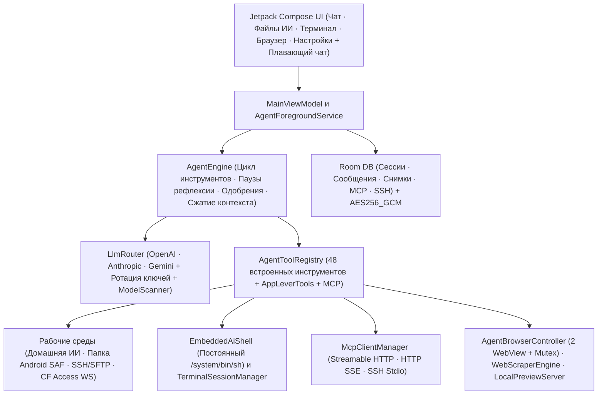

<div align="center">

# ForgeMind

**Автономный ИИ-агент и мульти-средовая инженерная рабочая станция для Android**

[](https://github.com/DIIIUA/ForgeMind/releases/latest)
[](https://github.com/DIIIUA/ForgeMind/actions/workflows/android-ci.yml)
[](LICENSE)
[-3ddc84?style=for-the-badge&logo=android&logoColor=white)](#сборка-и-тесты)
[](#стек-технологий)

**Язык документации:** [English](README.md) · **Русский**

*Нативный мобильный командный центр на Kotlin и Jetpack Compose для рассуждающих моделей, автономных циклов вызова инструментов, редактирования кода в Sora Editor со снэпшотами отката, встроенного и Termux/Cloudflare SSH-терминала, двух изолированных WebView и MCP-серверов.*

[**⬇ Скачать готовый `.apk` (GitHub Releases)**](https://github.com/DIIIUA/ForgeMind/releases/latest) · [Из коробки vs Termux](#что-работает-из-коробки-и-что-даёт-termux-ssh) · [Настройка за 1 минуту](#быстрая-настройка-за-1-минуту-termux--внешний-ssh--mcp) · [Возможности](#возможности) · [Архитектура](#архитектура) · [Лицензия](#лицензия-и-коммерческие-права)

</div>

---

## Скриншоты интерфейса

| Чат и Diff-карточки агента | Файлы ИИ и Sora Editor | Живой Shell и браузер ИИ | Встроенные гайды, SSH и MCP |
| :---: | :---: | :---: | :---: |
|  |  |  |  |

---

## Обзор

**ForgeMind** превращает Android-смартфон или планшет в полноценную автономную инженерную рабочую среду ИИ, не раздувая APK гигабайтными PRoot-контейнерами. Четыре ключевых преимущества архитектуры:

1. **Cloudflare Access WebSocket SSH (`wss://`) прямо из коробки** — подключение к домашним серверам и Termux за Cloudflare Zero Trust по заголовкам `CF-Access-Client-Id/Secret` **без проброса белых IP** и без бинарника `cloudflared` на телефоне.
2. **Sora Editor (TextMate) + авто-снэпшоты отката + локальный HTTP-сервер предпросмотра (`LocalPreviewServer`)** — полноценный редактор кода с подсветкой грамматик, мгновенным откатом изменений и живым loopback-превью рядом с чатом.
3. **Триада рабочих сред (`internal` + `saf` + `termux_ssh`) и `MCP SSH_STDIO`** — одновременная работа в песочнице приложения, выбранной папке телефона, локальном Termux и на удалённых серверах.
4. **Принудительная рефлексия (`thinkEveryToolCalls`) и безопасная автокомпакция на `78%`** — защита от бесконечных зацикливаний вызовов и переполнения контекста.

---

## Что работает из коробки и что даёт Termux SSH

Чистый APK **ForgeMind** работает сразу после установки и добавления API-ключа (или локального Ollama) и не требует никаких предустановленных пользовательских библиотек на телефоне:

| Контур | Сразу из коробки (только APK) | С чистым Termux (`127.0.0.1:2222`) или внешним SSH |
| :--- | :--- | :--- |
| **Файловые среды** | **Домашняя папка ИИ (`internal`)** + **Папка Android (`saf`)** через системный проводник | Полный доступ по SFTP/SSH к домашнему каталогу Termux (`~`) и внешним Linux-машинам |
| **Выполнение команд** | Постоянный процесс `/system/bin/sh` (`EmbeddedAiShell`) со стандартными POSIX / `toybox` утилитами Android (`ls`, `grep`, `sed`, `curl` и т.д.) | Полноценные пакеты Linux (`python3`, `nodejs`, `git`, `clang`, `ffmpeg`, `pytest`, `uvx`, `npx` и любые свои утилиты) |
| **Чтение документов и медиа** | Текст/код, текстовый слой `PDF` (`pdfbox-android`), XML-парсинг `DOCX`/`XLSX`/`PPTX`/`ODT`/`ODS`/`ODP`/`RTF`, просмотр `ZIP` и картинок (без встроенного OCR) | Любые собственные OCR / аналитические / медиа-пайплайны в Termux или на сервере (`tesseract`, `pymupdf`, `pandas` и др.) |
| **Редактор и веб** | **Sora Editor**, снэпшоты отката, два изолированных WebView, поиск DuckDuckGo, `LocalPreviewServer` | Запуск и живая отладка бэкендов (`FastAPI`, `Vite`, `Flask`, `Next.js`) в Termux или по SSH |
| **Голос и MCP** | Системные офлайн Android STT и TTS, облачные Whisper/TTS, HTTP и SSE MCP-шлюзы | Консольные **`SSH_STDIO` MCP-серверы** (`npx`, `uvx`, `python3`), запускаемые прямо внутри Termux или внешнего SSH |

> [!TIP]
> В каждый профильный раздел приложения (**Среды ИИ**, кнопка **`?` в Терминале**, **MCP-серверы** и **Голос**) встроены сворачиваемые карточки **Быстрого гайда** с копированием команд в один тап и готовыми шаблонами — без навязчивого стартового мастера на весь экран.

---

## Быстрая настройка за 1 минуту (Termux · Внешний SSH · MCP)

### А. Локальный Termux по SSH (1 минута)
1. Установите чистый [Termux](https://github.com/termux/termux-app/releases) (с F-Droid или GitHub Releases).
2. Вставьте в Termux одну команду (её также можно скопировать в один тап в **Настройки → Среды ИИ** или в **Терминале → `?`**):
   ```bash
   pkg update -y && pkg install -y openssh && passwd && sshd -p 2222
   ```
3. Выполните `whoami` в Termux, чтобы узнать свой логин (например, `u0_a312`), укажите его и заданный пароль в профиле `Termux (локальный)` (`127.0.0.1:2222`) в ForgeMind и нажмите **Сохранить**.

### Б. Внешний ПК или домашний сервер по SSH (без белых IP)
- **Вариант 1 — Tailscale (самый простой):** поставьте [Tailscale](https://tailscale.com/) на ПК и телефон, включите OpenSSH на компьютере и подключитесь в ForgeMind по адресу `100.x.y.z:22`.
- **Вариант 2 — Cloudflare Zero Trust Tunnel:** опубликуйте `ssh://localhost:22` через `cloudflared` на сервере, выпустите Service Token и включите переключатель **Туннель Cloudflare Access (`wss://`)** в настройках SSH ForgeMind.

### В. Подключение MCP-серверов
Откройте **Настройки → MCP-серверы** и нажмите на любой шаблон быстрого старта или кнопку **Добавить**:
- **Удалённые и домашние шлюзы (`STREAMABLE_HTTP` / `HTTP_SSE`):** укажите URL (`https://.../mcp` или `/sse`) и при необходимости авторизацию (`Bearer`, `Basic`, `API Key` или `CF-Access`).
- **Локальные CLI-серверы (`SSH_STDIO`):** запускаются напрямую внутри Termux или внешнего SSH (например, `npx -y @modelcontextprotocol/server-filesystem ~` или `python3 -m mcp_server_fetch`).

---

## Возможности

### 1. Мульти-провайдерный роутер LLM и сканер моделей
Поддержка нативных протоколов (`OPENAI_COMPAT`, `ANTHROPIC`, `GEMINI`) и 13 готовых профилей провайдеров:

| Провайдеры | Особенности |
| :--- | :--- |
| **OpenAI / Anthropic / Google Gemini** | Прямой SSE-стриминг, нативный вызов инструментов, настраиваемый бюджет рассуждений (thinking) |
| **OpenRouter / DeepSeek / Groq / xAI Grok / Mistral** | Быстрый инференс, автозагрузка списка моделей, единый OpenAI-совместимый поток |
| **Venice AI** | Запрос полного мультимодального каталога `/models?type=all` (`text`, `code`, `image`, `tts`, `asr`, `embedding`, `video`), чтение `model_spec` и фильтры категорий |
| **NVIDIA NIM / Cloudflare Workers AI / HuggingFace** | Открытые и специализированные модели |
| **Ollama и Custom OpenAI / LiteLLM** | Локальные модели в LAN / Termux / туннелях, пользовательские HTTP-заголовки JSON и резервный DNS-over-HTTPS |

### 2. Автономный движок агента и 48 встроенных инструментов
Работает внутри `AgentForegroundService` (`dataSync`), чтобы многошаговые задачи продолжались стабильно даже при сворачивании приложения:

<details>
<summary><strong>Нажмите, чтобы раскрыть все 48 встроенных инструментов и контуры защиты</strong></summary>

- **Среды, файлы и снимки отката (`internal`, `termux_ssh`, `saf`):**
  `check_environment_status`, `list_files`, `search_files`, `search_codebase`, `file_info`, `file_read`, `file_write`, `file_edit`, `file_move`, `file_delete`, `create_folder`, `archive_create`, `archive_extract`, `transfer_file`, `send_file_to_chat`, `snapshot_list`, `snapshot_restore`
- **Встроенный шелл, SSH и вкладки терминала:**
  `run_command`, `run_command_async`, `check_command_status`, `kill_command`, `terminal_list_tabs`, `terminal_open_tab`, `terminal_send`
- **Два изолированных WebView, веб-поиск и локальный сервер предпросмотра:**
  `web_search`, `web_scrape`, `browser_open`, `browser_agent_mode`, `browser_agent_navigate`, `browser_agent_inspect`, `browser_agent_act`, `browser_agent_eval_js`, `browser_agent_screenshot` (синхронизированы мьютексом и ожиданием отрисовки кадра), `preview_server_control`
- **Редактор кода, управление чатами, навигация, голос и MCP:**
  `editor_open_file`, `editor_list_tabs`, `chat_list_sessions`, `chat_search_history`, `chat_read_session`, `chat_manage`, `chat_export_markdown`, `context_compact`, `app_navigate`, `voice_speak`, `mcp_list_servers`, `mcp_connect`, `mcp_call_tool`, `mcp_read_resource`

</details>

### 3. Локализация (14 языков)
Мгновенное переключение языка интерфейса в **Настройки → Язык интерфейса**:

`Системный` · `English` · `Русский` · `Español` · `中文 (简体)` · `العربية` · `हिन्दी` · `Português` · `Français` · `Deutsch` · `日本語` · `한국어` · `Türkçe` · `Українська`

---

## Архитектура



---

## Стек технологий

- **Язык и сборка:** Kotlin `2.2.21`, Android Gradle Plugin `8.13.2`, KSP `2.2.21-2.0.5`, Java `17` + core library desugaring
- **UI:** Jetpack Compose BOM `2025.09.00`, Material 3, AppCompat per-app locales, Navigation Compose, Coil `2.7.0`, Sora Editor `0.23.6` (TextMate)
- **Хранение и защита данных:** Room `2.8.5`, DataStore Preferences, `androidx.security:security-crypto` (`AES256_GCM` для API-ключей и паролей/ключей SSH)
- **Сеть и парсинг:** OkHttp `4.12.0` (SSE + WebSockets + резервный DoH), `mwiede/jsch` `2.28.8` (SSH/SFTP), Jsoup `1.20.1`, PDFBox Android `2.0.27.0`

---

## Сборка и тесты

### Готовый APK
Скачайте свежую готовую сборку `.apk` прямо со страницы [**GitHub Releases**](https://github.com/DIIIUA/ForgeMind/releases/latest).

### Сборка из исходников
1. Установите JDK `17` и Android SDK (`compileSdk 36`, `minSdk 29`), укажите `ANDROID_HOME` (или `sdk.dir` в `local.properties`).
2. Запустите все модульные тесты и сборку отладочного APK:
   ```bash
   ./gradlew testDebugUnitTest assembleDebug
   ```

> [!NOTE]
> Репозиторий не содержит встроенных API-ключей, приватных адресов серверов или личных настроек. Все ключи провайдеров, учётные данные SSH и заголовки MCP задаются локально на устройстве и шифруются в `AES256_GCM`.

---

## Лицензия и коммерческие права

Copyright © 2026 **DIIIUA**.

- **Открытая лицензия (`GPL-3.0`):** Исходный код этого публичного репозитория распространяется по свободной лицензии [**GNU General Public License v3.0**](LICENSE) (одобренной OSI и FSF). Вы можете свободно изучать, собирать, модифицировать и распространять производные версии при соблюдении условий `GPL-3.0`.
- **Двойное лицензирование и публикация в магазинах приложений:** Как первоначальный правообладатель, **DIIIUA** сохраняет полное право распространять официальные сборки **ForgeMind** (включая платные версии, подписки, закрытые расширения и сборки для Google Play, Apple App Store, Galaxy Store и корпоративных заказчиков) на отдельных коммерческих условиях.
- **Лицензионное соглашение для контрибьюторов:** Отправляя pull request или иной вклад в данный репозиторий, вы предоставляете **DIIIUA** бессрочную, неисключительную, безвозмездную и безотзывную всемирную лицензию на использование, модификацию и распространение вашего вклада как на условиях `GPL-3.0`, так и в коммерческих / магазинных сборках, сохраняя за собой авторство на свой вклад. Название и бренд **ForgeMind** принадлежат **DIIIUA**.
