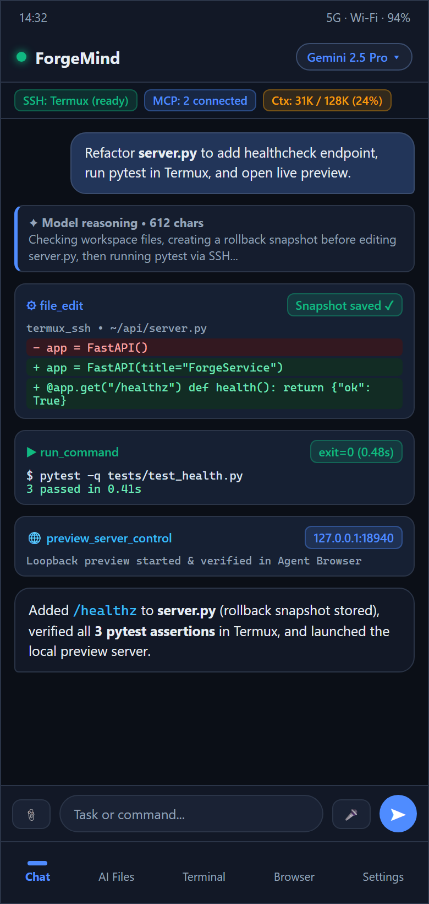
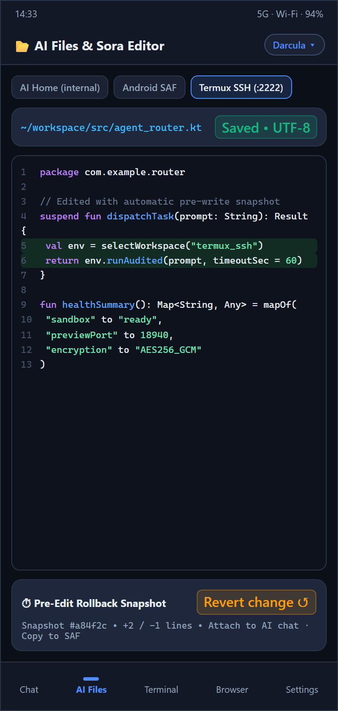
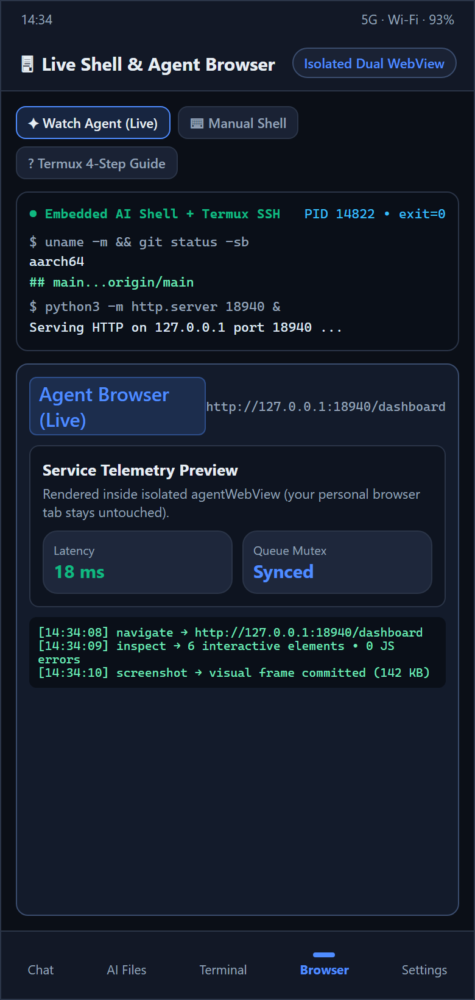
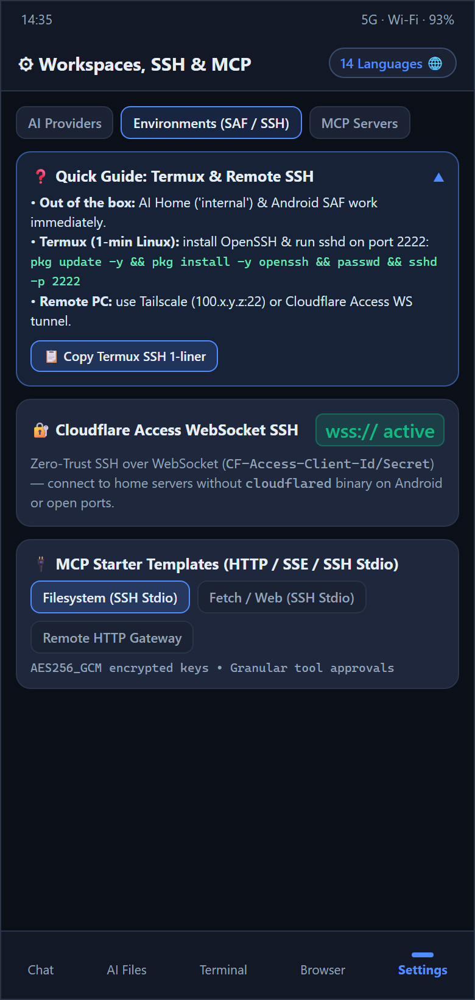
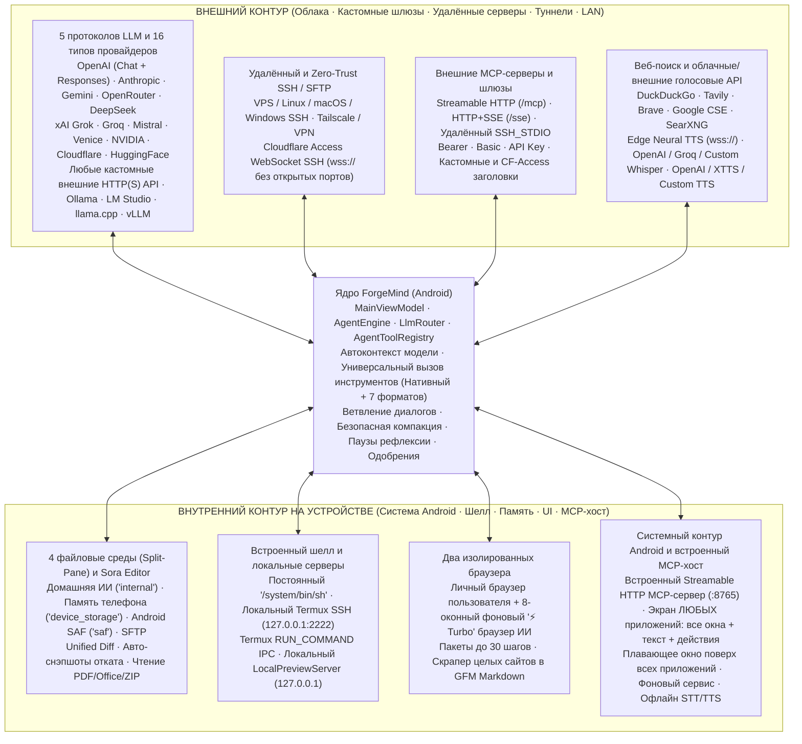

<div align="center">

# ForgeMind

**Автономная инженерная ИИ-станция и универсальный хаб внешних и внутренних соединений для Android**

[&color=10b981)](https://github.com/DIIIUA/ForgeMind/releases/latest)
[](https://github.com/DIIIUA/ForgeMind/actions/workflows/android-ci.yml)
[](LICENSE)
[-3ddc84?style=for-the-badge&logo=android&logoColor=white)](#установка-и-сборка)
[](#стек-технологий)

**Язык документации:** [English](README.md) · **Русский** · [**Полная архитектурная карта Graphify (1571 узел · 3586 связей)**](docs/GRAPHIFY_ARCHITECTURE.md)

*Нативный командный центр на Kotlin и Jetpack Compose, объединяющий **весь внешний и внутренний контур соединений** смартфона: облачные флагманские API, любые кастомные внешние HTTP/HTTPS-шлюзы, домашние и LAN-серверы, туннели Cloudflare Zero-Trust WebSocket SSH (`wss://`), удалённый и локальный Termux SSH/SFTP, двусторонний MCP (`Streamable HTTP` · `SSE` · `SSH stdio` + встроенный MCP-сервер телефона), 4 файловые среды с Sora Editor и снэпшотами отката, 8-оконный `⚡ Turbo` браузер ИИ, считывание и управление экраном любых приложений во всех открытых окнах (Window-Tag DOM), плавающий чат поверх системы и мульти-провайдерный голос.*

[**⬇ Скачать готовый `.apk` (GitHub Releases)**](https://github.com/DIIIUA/ForgeMind/releases/latest) · [Матрица всех соединений (Внешние ↔ Внутренние)](#единая-матрица-соединений-внешний-и-внутренний-контуры) · [56 встроенных инструментов + MCP](#56-встроенных-инструментов-и-двусторонний-mcp) · [Быстрая настройка](#быстрая-настройка-за-1-минуту) · [Карта Graphify](docs/GRAPHIFY_ARCHITECTURE.md) · [Лицензия](#лицензия-и-коммерческие-права)

</div>

---

## Скриншоты интерфейса

| Чат и Diff-карточки агента | Двухпанельные файлы и Sora Editor | Живой Shell и браузер ИИ | Встроенные гайды, SSH и MCP |
| :---: | :---: | :---: | :---: |
|  |  |  |  |

---

## Единая матрица соединений (Внешний и Внутренний контуры)

**ForgeMind** спроектирован не как узкий клиент для одного типа нейросетей, а как **полная двуконтурная система (Внешняя + Внутренняя)**, принимающая и связывающая все виды сетевых, серверных, туннельных и внутрисистемных подключений Android без раздувания APK гигабайтными PRoot-образами:



### 1. Внешний функционал и принимаемые соединения
- **5 нативных протоколов LLM (`WireProtocol`):**
  `OPENAI_COMPAT` (`/chat/completions` SSE и обычный JSON), `OPENAI_RESPONSES` (`/responses`), `ANTHROPIC` (`/v1/messages` SSE с блоками размышлений), `GEMINI` (`streamGenerateContent` SSE) и `OLLAMA_NATIVE` (`/api/chat` NDJSON + `/api/show`).
- **Все классы ИИ-провайдеров (`CLOUD` · `CUSTOM` · `LOCAL_LAN`):**
  - **12+ облачных платформ и роутеров:** OpenAI, Anthropic Claude, Google Gemini, OpenRouter, DeepSeek, xAI Grok, Groq, Mistral, Venice AI (полный мультимодальный каталог `/models?type=all` и `model_spec`), NVIDIA NIM, Cloudflare Workers AI, HuggingFace.
  - **Полностью кастомные внешние нейросети и шлюзы (`CUSTOM`):** подключение к любому внешнему `http(s)://` API (поддержка `#` для точного URL без дописывания путей), **6 режимов авторизации** (`AUTO`, `NONE`, `BEARER`, `X_API_KEY`, `QUERY_KEY`, `CUSTOM_HEADER` с префиксом), произвольные JSON-заголовки и `extraBodyJson`, опция частных/самоподписанных сертификатов (`allowInsecureSsl`), резервный **DNS-over-HTTPS (DoH)** при блокировках DNS, живые индикаторы «онлайн / оффлайн» и авто-ротация пула API-ключей при `429/401/402/403`.
  - **Домашние, Tailscale/VPN и локальные серверы (`LOCAL_LAN`):** точечный поиск по адресу за ~1 сек (**Найти по адресу** / **Подключить сразу**) и параллельный сканер `/24` сети для Ollama, LM Studio, `llama.cpp`, KoboldCpp, vLLM, SGLang, LocalAI, Jan, GPT4All, OpenWebUI и LiteLLM.
- **Удалённый SSH, SFTP и туннели Cloudflare Zero Trust:**
  - Подключение к любым внешним Linux/macOS/Windows серверам по паролю или приватному ключу OpenSSH/PEM напрямую, через VPN или Tailscale.
  - Нативный **Cloudflare Access WebSocket SSH (`wss://`)**: прямое туннелирование SSH/SFTP через Cloudflare Zero Trust по заголовкам `CF-Access-Client-Id` и `CF-Access-Client-Secret` **без открытых портов** и без бинарника `cloudflared` на телефоне.
- **Исходящий MCP-клиент (3 вида транспорта):**
  `STREAMABLE_HTTP` (стандарт 2025-03-26 `POST /mcp`, сессии, пагинация схем, `initialize.instructions`, поддержка Code Mode шлюзов и картинок `PNG/WEBP/JPEG`), `HTTP_SSE` и `SSH_STDIO` (запуск `npx` / `uvx` / `python3` MCP-серверов прямо на удалённом SSH-сервере или в Termux).
- **Внешний веб-поиск и голосовые сервисы:**
  5 поисковых систем (DuckDuckGo, Tavily, Brave, Google CSE, **SearXNG**), бесплатный потоковый **Microsoft Edge Neural TTS (`wss://`)**, облачные и кастомные **Whisper STT** (Groq, OpenAI, Custom URL) и синтезаторы **OpenAI TTS / XTTS v2 (локальный или внешний сервер)**.

### 2. Внутренний функционал на устройстве и входящие подключения
- **4 одновременные файловые среды и двухпанельный проводник (Split-Pane):**
  **Домашняя папка ИИ (`internal`)**, **Память телефона (`device_storage`)**, **Папка Android (`saf`)** и **SFTP (`termux_ssh`)** с прямым переносом файлов между окнами, работой с `ZIP`, встроенным чтением `PDF` и офисных форматов (`DOCX`, `XLSX`, `PPTX`, `ODT`, `ODS`, `ODP`, `RTF`), редактором кода **Sora Editor (TextMate)**, Diff-карточками и автоматическими снэпшотами отката перед каждой правкой.
- **Постоянный физический шелл, контур Termux и локальный веб-сервер:**
  Встроенный неубиваемый процесс `/system/bin/sh` (`EmbeddedAiShell`), связка с локальным Termux (`127.0.0.1:2222` SSH + системный `RUN_COMMAND` IPC), мульти-вкладочный терминал (**Агент Live** / **Ручной**) с выбором цветов и встроенный HTTP-сервер предпросмотра `LocalPreviewServer` (`127.0.0.1:<port>`).
- **Встроенный MCP-сервер на телефоне (`ForgeMcpHostServer`):**
  Принимает входящие `Streamable HTTP` MCP-запросы (`127.0.0.1:8765`, `/mcp` и `/health`, защита `Bearer`-токеном, контроль доступа к записи и shell) от локальных клиентов, Termux, `adb forward` или защищённых туннелей.
- **Два изолированных WebView и 8-оконный `⚡ Turbo` браузер ИИ:**
  Личный браузер пользователя полностью отделён от 8 фоновых окон ИИ (вертикальная колонка вкладок, отсечение рекламы/трекеров/тяжёлых шрифтов, пакеты `browser_agent_batch` до 30 действий за ход и параллельная выгрузка целых сайтов в GFM Markdown через `web_scrape_site`).
- **Живое управление экраном Android (Window-Tag DOM) и плавающее окно:**
  - **Считывание экрана любых приложений, а не только ForgeMind:** ИИ получает содержимое экрана стороннего приложения в виде структурированного текста, а не угадывает по скриншоту — все видимые надписи, сообщения, пункты списков, значения полей и описания элементов, плюс интерактивные элементы, пронумерованные тегами `[#1..#k]` (`screen_read_windows`; по умолчанию весь видимый текст, `only_interactive=true` — только кликабельное).
  - **Ориентация во всех окнах сразу** `[W1..Wn]`: основное приложение, обе половины split-screen (и разделитель), плавающие и всплывающие окна, клавиатура (IME) и системные панели; определяется, какое приложение реально на переднем плане (с обходом наложений HyperOS / MIUI), есть фильтр по пакету или заголовку окна. Собственное плавающее окно ForgeMind скрывается из снимка, если не указано `include_self=true`.
  - **Действия внутри этих приложений:** нажатие / долгое нажатие / ввод и дописывание Unicode-текста / прокрутка по тегу, нажатие по видимой надписи или координатам `x,y`, свайпы, ожидание появления текста `wait_text`, запуск приложения `open_app`, системные Назад / Домой / Недавние / Шторка / Быстрые настройки — по одному (`screen_act_tag`) или целой цепочкой за один вызов без пауз (`screen_act_batch`).
  - **Аппаратный снимок экрана по запросу** (`screen_capture`, Android 11+, `webp`/`jpeg`/`png`, при желании вместе с деревом тегов) — без фоновой записи.
  - *Включается пользователем:* работает только после включения службы специальных возможностей ForgeMind в настройках Android. Содержимое полей паролей Android скрывает сам, а приложения с `FLAG_SECURE` запрещают снимки экрана.
  - Плюс плавающий мини-чат поверх любых приложений (`FloatingChatService`), фоновый `AgentForegroundService` и системные офлайн STT/TTS.

---

## Автоконтекст и универсальное исполнение команд для ВСЕХ моделей

Независимо от того, подключена ли облачная модель, корпоративный прокси или кастомная `7B–9B` GGUF / Uncensored сборка:
- **Автоопределение окна контекста + переключение в 1 тап:** чтение реального контекста с сервера (`/v1/models`, LM Studio `/api/v0/models`, `llama.cpp` `/props`, Ollama `/api/show`) + быстрые чипы `Авто | 4K..1M | Своё…` прямо в шторке выбора модели.
- **Единый протокол инструментов:** полные схемы для больших моделей, автоматический компактный режим для узких контекстов (с сохранением доступа ко всем MCP через `mcp_call_tool`), разбор **7 текстовых форматов вызова** (`<tool_call>`, DeepSeek `<｜tool▁calls▁begin｜>`, DSML, `<function=...>`, `<invoke>`, `[TOOL_CALLS]`, Python-вызовы), авто-переключение при HTTP `400/404/422/500` и самокоррекция невыполненных `bash`-блоков.

---

## 56 встроенных инструментов и двусторонний MCP

Полный список всех **56 встроенных инструментов (`29` базовых + `27` рычагов приложения)**, 66 архитектурных кластеров и графа связей (`1571` узел, `3586` рёбер) приведён в документе [**docs/GRAPHIFY_ARCHITECTURE.md**](docs/GRAPHIFY_ARCHITECTURE.md). В интерфейс также встроены: ветвление диалогов (`< 1/2 >`), предупреждение перед ручным сжатием контекста, инструкция чата в меню `⋮`, сворачиваемая до тонких цветных линий полоса всех подключений, полноэкранный зум/скачивание картинок, **Студия дизайна/темы** (цвета и прозрачность всех панелей) и **14 языков**.

---

## Быстрая настройка за 1 минуту

- **Облачные и кастомные внешние ИИ (`Настройки → Провайдеры AI`):** выберите готовый профиль и вставьте ключи (с авто-ротацией) или нажмите **Кастомная внешняя ИИ**, задав любой URL, протокол и тип авторизации.
- **Локальные / Tailscale / LAN серверы (`Найти локалки в сети`):** введите `IP:порт` и нажмите **Найти по адресу** (~1 сек) или **Подключить сразу**, либо запустите сканер всей сети Wi-Fi / LAN.
- **Termux, удалённый SSH и Cloudflare Zero Trust (`Настройки → Среды ИИ`):** подключите локальный Termux (`pkg update -y && pkg install -y openssh && passwd && sshd -p 2222`), внешний сервер по IP/Tailscale или включите **Туннель Cloudflare Access (`wss://`)**.
- **Внешние MCP и встроенный MCP-сервер телефона (`Настройки → MCP-серверы`):** подключите `STREAMABLE_HTTP` / `HTTP_SSE` / `SSH_STDIO` шлюзы или включите встроенный сервер `:8765`.

---

## Установка и сборка

- **Готовый APK:** скачайте `ForgeMind-v0.2.0-alpha.apk` в разделе [**GitHub Releases**](https://github.com/DIIIUA/ForgeMind/releases/latest) (или добавьте `https://github.com/DIIIUA/ForgeMind` в **Obtainium** с включёнными pre-release).
- **Сборка и прогон всех 96 тестов из исходников:**
  ```bash
  ./gradlew testDebugUnitTest assembleDebug
  ```

---

## Стек технологий

- **Язык и сборка:** Kotlin `2.2.21`, AGP `8.13.2`, KSP `2.2.21-2.0.5`, Java `17` (`minSdk 29`, `compileSdk 36`)
- **UI:** Jetpack Compose BOM `2025.09.00`, Material 3, Sora Editor `0.23.6` (TextMate), Coil `2.7.0`
- **Хранение и безопасность:** Room `2.8.5` (схемы v1–v5), DataStore Preferences, `AES256_GCM`, ZIP-архивы
- **Сеть и парсинг:** OkHttp `4.12.0` (SSE, WebSockets, Cloudflare WSS-SSH, Edge TTS WSS, DoH), `mwiede/jsch` `2.28.8` (SSH/SFTP), Jsoup `1.20.1`, PDFBox Android `2.0.27.0`

---

## Лицензия и коммерческие права

Copyright © 2026 **DIIIUA**.

- **Открытая лицензия (`GPL-3.0`):** Исходный код этого публичного репозитория распространяется по свободной лицензии [**GNU General Public License v3.0**](LICENSE) (одобренной OSI и FSF). Вы можете свободно изучать, собирать, модифицировать и распространять производные версии при соблюдении условий `GPL-3.0`.
- **Двойное лицензирование и публикация в магазинах приложений:** Как первоначальный правообладатель, **DIIIUA** сохраняет полное право распространять официальные сборки **ForgeMind** (включая платные версии, подписки, закрытые расширения и сборки для Google Play, Apple App Store, Galaxy Store и корпоративных заказчиков) на отдельных коммерческих условиях.
- **Лицензионное соглашение для контрибьюторов:** Отправляя pull request или иной вклад в данный репозиторий, вы предоставляете **DIIIUA** бессрочную, неисключительную, безвозмездную и безотзывную всемирную лицензию на использование, модификацию и распространение вашего вклада как на условиях `GPL-3.0`, так и в коммерческих / магазинных сборках, сохраняя за собой авторство на свой вклад. Название и бренд **ForgeMind** принадлежат **DIIIUA**.
