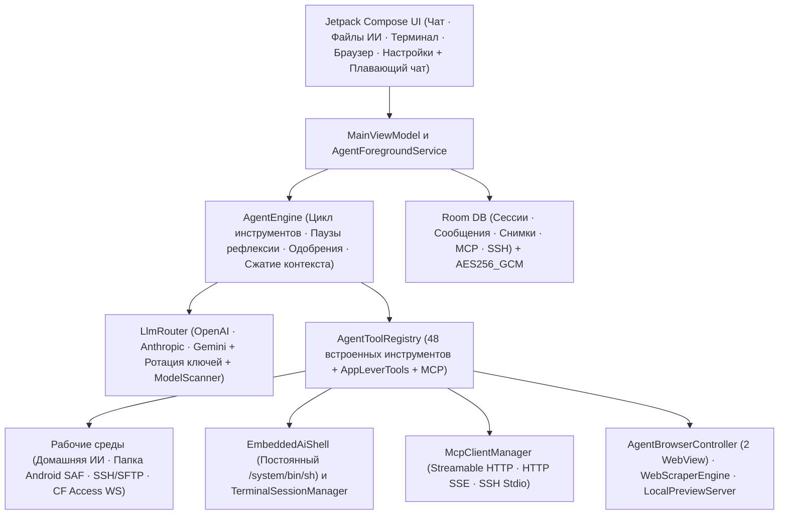

<div align="center">

# ForgeMind

**Автономный ИИ-агент и мульти-провайдерная инженерная среда для Android**

[](https://github.com/DIIIUA/ForgeMind)
[-3ddc84?style=for-the-badge&logo=android&logoColor=white)](#стек-технологий)
[](#стек-технологий)
[](#интерфейс-и-рабочие-среды)

**Язык документации:** [English](README.md) · **Русский**

*Нативный мобильный командный центр для рассуждающих моделей, автономных циклов вызова инструментов, работы с кодом и документами в нескольких средах, встроенного локального и SSH/Termux-терминала, MCP-серверов, плавающего окна чата и голосового общения.*

[Обзор](#обзор) · [Ключевые особенности](#ключевые-особенности) · [Возможности](#возможности) · [Архитектура](#архитектура) · [Сборка и тесты](#сборка-и-тесты) · [Локализация (14 языков)](#локализация-14-языков)

</div>

---

## Обзор

**ForgeMind** превращает Android-смартфон или планшет в полноценную автономную инженерную рабочую среду ИИ, а не просто оболочку для переписки. Приложение написано нативно на Kotlin и Jetpack Compose и даёт языковым моделям контролируемый и прозрачный доступ к изолированной песочнице приложения, папкам Android Storage Access Framework (SAF), постоянно живому встроенному шеллу `/system/bin/sh`, хостам Termux/SSH, двум изолированным WebView и внешним серверам Model Context Protocol (MCP) — с локальным шифрованием ключей (`AES256_GCM`) и гибким подтверждением действий.

## Ключевые особенности

- **5 основных вкладок + плавающее окно чата:** `Чат`, `Файлы ИИ`, `Терминал`, `Браузер` и `Настройки`, а также перетаскиваемое **плавающее окно чата** поверх любых приложений с уголком изменения размера **слева внизу** (в стороне от кнопки отправки).
- **Двухрежимный терминал и встроенный физический шелл ИИ (`EmbeddedAiShell`):** Переключение между режимами **Смотреть за агентом (Live)** и **Вручную**, а также постоянный процесс `/system/bin/sh` внутри песочницы приложения, который сохраняет `cd`/`export` между командами и продолжает работать даже при обрыве SSH или отсутствии Termux.
- **Встроенный просмотр документов, изображений и архивов:** Открывайте изображения (`PNG`, `JPG`, `WEBP`, `GIF`, `BMP`, `HEIC`), `PDF`, офисные документы (`DOCX`, `XLSX`, `PPTX`, `ODT`, `ODS`, `ODP`, `RTF`), архивы (`ZIP`, `JAR`, `APK`), разметку Markdown и исходный код прямо внутри **Файлов ИИ** и вложений чата.
- **Полный каталог моделей Venice AI и 13 провайдеров:** Нативный стриминг по протоколам `OPENAI_COMPAT`, `ANTHROPIC` и `GEMINI`, включая полную загрузку всех моделей Venice AI (`/models?type=all` — текст, код, генерация изображений, TTS, ASR, эмбеддинги, видео) с фильтрацией по категориям и быстрым поиском.
- **14 языков интерфейса:** Английский по умолчанию (`res/values/strings.xml`), полная русская локализация (`res/values-ru/strings.xml`) и ещё 12 популярных языков с мгновенным переключением в настройках.

---

## Возможности

### 1. Мульти-провайдерный роутер LLM и сканер моделей
Поддержка нативных протоколов (`OPENAI_COMPAT`, `ANTHROPIC`, `GEMINI`) и 13 готовых профилей провайдеров:

| Провайдеры | Особенности |
| :--- | :--- |
| **OpenAI / Anthropic / Google Gemini** | Прямой SSE-стриминг, нативный вызов инструментов, настраиваемый бюджет рассуждений (thinking) |
| **OpenRouter / DeepSeek / Groq / xAI Grok / Mistral** | Быстрый инференс, автозагрузка списка моделей, единый OpenAI-совместимый поток |
| **Venice AI** | Запрос полного мультимодального каталога `/models?type=all` (`text`, `code`, `image`, `tts`, `asr`, `embedding`, `video`), чтение `model_spec` и фильтры категорий |
| **NVIDIA NIM / Cloudflare Workers AI / HuggingFace** | Открытые и специализированные модели |
| **Ollama и Custom OpenAI / LiteLLM** | Локальные модели в LAN / Termux / туннелях, пользовательские HTTP-заголовки JSON и резервный DNS-over-HTTPS |

- **Ротация API-ключей:** Несколько ключей на одного провайдера с автоматическим переключением при лимитах (`429` / quota).
- **Автосжатие контекста:** Умная суммаризация длинных диалогов (`compactThresholdPercent`, по умолчанию `78%`) без разрыва связок вызовов инструментов.

### 2. Автономный движок агента и 48 встроенных инструментов
Работает внутри `AgentForegroundService` (`dataSync`), чтобы длинные многошаговые задачи не обрывались при сворачивании приложения:

<details>
<summary><strong>Нажмите, чтобы раскрыть все 48 встроенных инструментов и контуры защиты</strong></summary>

- **Среды, файлы и снимки отката (`internal`, `termux_ssh`, `saf`):**
  `check_environment_status`, `list_files`, `search_files`, `search_codebase` (поиск по коду), `file_info`, `file_read` (построчное чтение и извлечение текста PDF через `pdfbox-android`), `file_write`, `file_edit` (точная замена + unified diff), `file_move`, `file_delete`, `create_folder`, `archive_create`, `archive_extract`, `transfer_file`, `send_file_to_chat`, `snapshot_list`, `snapshot_restore`
- **Встроенный шелл, SSH и вкладки терминала:**
  `run_command` (SSH/Termux с автоматическим переключением на постоянный встроенный `/system/bin/sh`), `run_command_async` (фоновый PID + лог), `check_command_status`, `kill_command`, `terminal_list_tabs`, `terminal_open_tab`, `terminal_send`
- **Два изолированных WebView, веб-поиск и локальный сервер предпросмотра:**
  `web_search` (DuckDuckGo, Tavily, Brave, Google CSE, SearXNG), `web_scrape`, `browser_open`, `browser_agent_mode`, `browser_agent_navigate`, `browser_agent_inspect` (DOM + интерактивные элементы + ошибки JS-консоли), `browser_agent_act` (`click`, `type`, `scroll`, `wait`, `back`, `forward`, `reload`, `clear`), `browser_agent_eval_js`, `browser_agent_screenshot`, `preview_server_control`
- **Редактор кода, управление чатами, навигация и голос:**
  `editor_open_file`, `editor_list_tabs`, `chat_list_sessions`, `chat_search_history`, `chat_read_session`, `chat_manage`, `chat_export_markdown`, `context_compact`, `app_navigate`, `voice_speak`
- **Model Context Protocol (MCP):**
  `mcp_list_servers`, `mcp_connect`, `mcp_call_tool`, `mcp_read_resource` + динамическое подключение инструментов активных MCP-серверов (`STREAMABLE_HTTP`, `HTTP_SSE`, `SSH_STDIO`), проброс серверных инструкций `initialize.instructions`, поддержка Code Mode / шлюзов и бинарных изображений (`PNG`/`WEBP`/`JPEG`).
- **Контроль и безопасность:**
  - Гибкие категории автоодобрения (чтение/запись, удаление файлов, shell, JS в браузере, MCP), белые и чёрные списки инструментов и перехват разрушительных shell-команд (`rm -rf`, `mkfs` и т.д.)
  - Автоматические **снимки файлов до правки** (`FileSnapshotEntity`) для мгновенного отката
  - Ограничитель итераций (`maxTurns`, по умолчанию `100`) и **принудительные паузы на осмысление** (`thinkEveryToolCalls`, по умолчанию `25`)

</details>

### 3. Интерфейс и рабочие среды
Пять вкладок нижнего меню (`AppSection`) и системный плавающий мини-чат:

1. **Чат:** Потоковый Markdown и блоки кода, сворачиваемый ход рассуждений, карточки вызовов инструментов с diff-подтверждением, повтор и редактирование сообщений, прикрепление любых файлов/картинок/документов, приём файлов через системное меню «Поделиться» (`ACTION_SEND`), папки чатов, экспорт в Markdown и полное резервное копирование в ZIP.
2. **Файлы ИИ (`internal`, `saf`, `termux_ssh`):**
   - **Домашняя ИИ (`internal`):** Внутренняя песочница приложения (`/data/data/com.forgemind.app/files/workspaces/<project>`).
   - **Папка Android (`saf`):** Любая папка в памяти телефона, выбранная пользователем через стандартный системный проводник Android Storage Access Framework (`ACTION_OPEN_DOCUMENT_TREE`) — удобный общий мост между телефоном и ИИ без запроса полного доступа ко всей памяти устройства.
   - **Termux / SSH (`termux_ssh`):** Работа по SFTP/SSH с локальным Termux (`порт 2222`) или внешними Linux-серверами (включая **WebSocket SSH через Cloudflare Access**).
   - **Встроенный просмотрщик и Sora Editor:** Просмотр изображений с зумом, `PDF`, документов `DOCX`/`XLSX`/`PPTX`/`ODT`/`ODS`/`ODP`/`RTF`, содержимого `ZIP`-архивов, форматированного Markdown и редактирование кода с подсветкой синтаксиса TextMate.
3. **Терминал:**
   - **Смотреть за агентом (Live):** Живая лента всех команд и выводов агента во встроенном шелле ИИ и по SSH/Termux.
   - **Вручную:** Полноценные интерактивные вкладки SSH/Termux и прямой ввод команд во встроенный локальный `/system/bin/sh` с панелью быстрых клавиш (`ESC`, `TAB`, `CTRL+C`, стрелки, сниппеты).
4. **Браузер:** Два независимых `WebView` — личный браузер пользователя (**Обычный**) и изолированный браузер ИИ (**Агент (Live)**) с живой лентой действий, инспектором DOM, консолью JS и встроенным HTTP-сервером `LocalPreviewServer` для предпросмотра созданных веб-приложений.
5. **Настройки:** Выбор языка (14 языков), переключатель плавающего чата, настройка провайдеров и API-ключей, реестр MCP-серверов, профили SSH/SFTP и Cloudflare Access, поисковые движки, голосовой контур и правила подтверждения инструментов.

### 4. Голосовой контур (STT и TTS)
- **Распознавание речи (STT):** Groq Whisper (`whisper-large-v3-turbo`), OpenAI Whisper, произвольный Whisper-совместимый сервер или офлайн-распознавание Android `SpeechRecognizer` (с опциональным автопереключением облако ↔ офлайн).
- **Синтез речи (TTS):** Потоковый локальный или внешний XTTS v2, OpenAI / совместимый TTS (`gpt-4o-mini-tts`) или системный синтезатор Android — с живой регулировкой скорости речи, высоты тона и автоматическим пропуском блоков кода (`skipCodeInTts`).

---

## Локализация (14 языков)

Базовые ресурсы приложения выполнены на английском языке (`res/values/strings.xml`), а в разделе **Настройки → Язык интерфейса** доступно мгновенное переключение между 14 вариантами:

`Системный` · `English` · `Русский` · `Español` · `中文 (简体)` · `العربية` · `हिन्दी` · `Português` · `Français` · `Deutsch` · `日本語` · `한국어` · `Türkçe` · `Українська`

---

## Архитектура



---

## Стек технологий

- **Язык и сборка:** Kotlin `2.2.21`, Android Gradle Plugin `8.13.2`, KSP `2.2.21-2.0.5`, Java `17` + core library desugaring
- **UI:** Jetpack Compose BOM `2025.09.00`, Material 3, AppCompat per-app locales, Navigation Compose, Coil `2.7.0`, Sora Editor `0.23.6` (TextMate)
- **Хранение и защита данных:** Room `2.8.5`, DataStore Preferences, `androidx.security:security-crypto` (`AES256_GCM` для API-ключей и паролей/ключей SSH)
- **Сеть и парсинг:** OkHttp `4.12.0` (SSE + WebSockets + резервный DoH), `mwiede/jsch` `2.28.8` (SSH/SFTP), Jsoup `1.20.1`, PDFBox Android `2.0.27.0`

---

## Сборка и тесты

### Требования
- Android Studio / Android SDK (`compileSdk 36`, `minSdk 29`)
- JDK 17

### Команды
1. Укажите `ANDROID_HOME` (или пропишите `sdk.dir=<путь-к-android-sdk>` в `local.properties`).
2. Запустите все модульные тесты и сборку отладочного APK:
   ```bash
   ./gradlew testDebugUnitTest assembleDebug
   ```
3. *(Опционально)* Соберите профилируемую benchmark-сборку:
   ```bash
   ./gradlew assembleBenchmark
   ```

> [!NOTE]
> Репозиторий не содержит встроенных API-ключей, приватных адресов серверов или учётных данных. Все ключи провайдеров, настройки SSH и заголовки MCP задаются пользователем локально на устройстве и хранятся в зашифрованном хранилище `AES256_GCM`.
